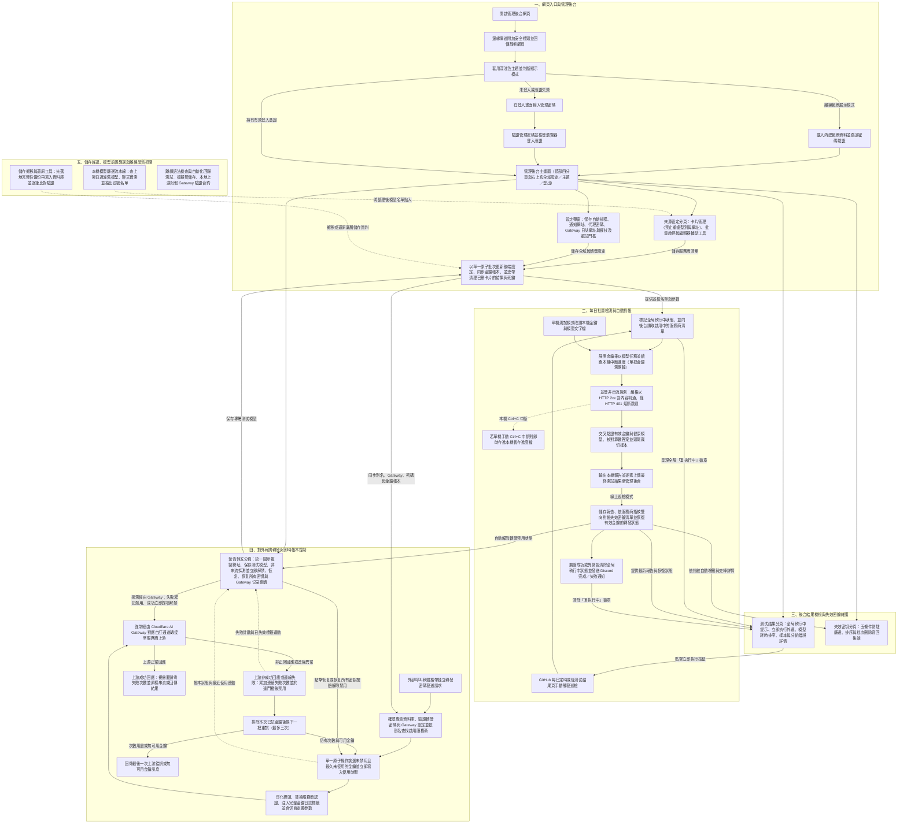
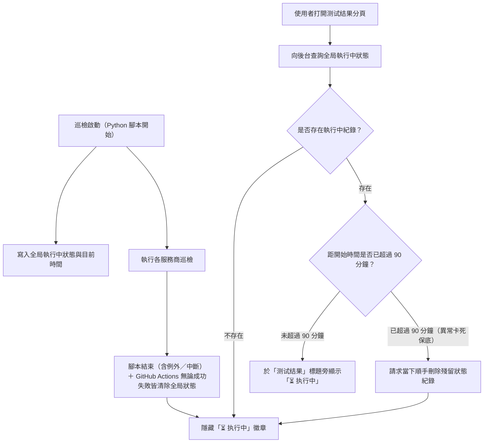
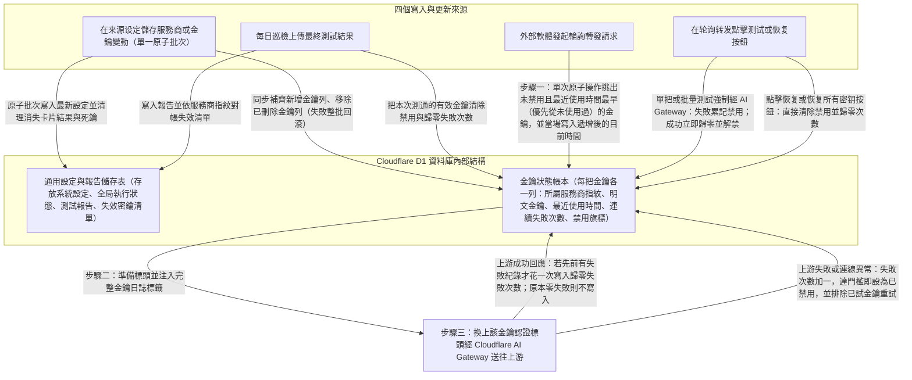

# 專案架構與整體流程說明

本文件專為**第一次接觸本專案**的讀者設計，採由上而下、從宏觀到細節的閱讀順序，全面拆解系統的資料夾分工、跨端運作流程，以及最核心的**「測試儲存邏輯」**、**「D1 帳本流向」**與**「輪詢轉發設計」**：

1. **一句話看懂專案**與**各資料夾內容功能**（精簡定位，不作冗餘逐檔流水帳）。
2. **整體代碼流程圖**：**完全不使用任何函式或變量名稱**，只以畫面上／服務上看得到的名稱與功能實際動作作為名詞。
3. **功能名稱與流程圖名詞對照表**：把流程圖名詞對應回真實功能名稱與跨檔案協作位置。
4. **核心設計深潛**：補上 **D1 關鍵流程圖**、**雙向同步防護流程圖**、**`⏳ 执行中` 判定流程圖**，以及指紋格式、API 清單、JSON vs SQL 優缺點、LRU 挑鑰情境表、標頭淨化、環境變數盤點與各種邊界機制。

---

## 一句話看懂這個專案

這是一個架構在 **Cloudflare Pages** 與 **GitHub Actions** 上的**多服務商 API 金鑰檢測與輪詢轉發平台**：

- **日常巡檢**：在網頁後台維護各家 API 服務商的金鑰與模型清單，由每日自動排程（或「`测试结果`」頁手動觸發／本機執行）直接向各服務商 `api_base` 發送純非串流請求並發測試「每把金鑰 × 每個模型」，彙整可用金鑰、可用模型、總耗時、思考能力與失敗原因，並依服務商指紋自動對帳失效清單與發送 Discord 通知。
- **對外轉發**：同一份服務商設定只要填上轉發別名並於 Cloudflare AI Gateway 建立對應 Custom Provider（`custom-{別名}`），外部軟體與「`轮询转发`」手動測試即可輪流使用未禁用的金鑰呼叫上游，並**100% 經由唯一整合的 Cloudflare AI Gateway 轉接與記錄日誌**（不設無日誌直連退回，亦未適配其他閘道平台）。轉發期間遇錯會自動累計失敗次數、達門檻禁用並換下一把重試；待手動測試成功、人工按恢復或下次每日巡檢證實恢復後重新投入輪用。

---

## 一、各資料夾的內容與功能

### 1.1 目錄結構總覽

```text
api-test/
├── .github/workflows/       # GitHub Actions 每日定時與手動巡檢工作流
├── public/                  # Cloudflare Pages 靜態管理介面 ＋ 邊緣後端閘道
├── scripts/                 # 資料庫儲存層（KV → D1）備份、搬移與還原工具
├── tests/                   # 全離線自動化回歸測試套件
├── local_test/              # 本機端的模型上架日篩選與對話實測流水線及廠商快照
├── models_list/             # 整理好的各服務商模型逗號清單參考庫
├── docs/                    # 本架構文件、設計決策紀錄與歷史規劃文件
├── async_test_keys.py       # 核心多金鑰 × 多模型非同步並發檢測腳本
├── package.json / lock      # Node.js 開發預覽、語法檢查、測試與搬移指令入口
├── requirements.txt         # Python 相依套件清單（aiohttp 等）
├── README.md / AGENTS.md    # 部署維運手冊與協作規範
└── .env.example / .gitignore
```

> [!NOTE]
> 本機開發或執行腳本時還會出現已列入 `.gitignore`、不進版控的項目：`.dev.vars`（Wrangler 本機密鑰）、`.wrangler/`（Wrangler 本機模擬 KV 與 D1 SQLite 狀態）、`node_modules/`、`__pycache__/`、`backups/`（含明文金鑰的搬移還原備份檔）、`valid_keys/`（單機測試模式讀取的金鑰目錄）、`checkpoint.json` 與 `async_test_results.json`。

### 1.2 每個資料夾的職責定位

| 資料夾／位置 | 核心內容與實際功能 | 在系統中如何與其他區域連動 |
|---|---|---|
| **根目錄（`/`）** | 放置每日並發測試引擎 [async_test_keys.py](../async_test_keys.py)、Node/Python 設定與指令入口（[package.json](../package.json)、[requirements.txt](../requirements.txt)）及操作手冊（[README.md](../README.md)）。 | 測試引擎連線 `public/` 閘道讀取設定並回傳進度與結果；亦可脫離雲端，改讀 `valid_keys/` 與 `models_list/` 單機運行。 |
| **`.github/workflows/`** | 放置自動化排程檔 [main.yml](../.github/workflows/main.yml)（每天 UTC 00:00 自動跑或手動觸發，最長 90 分鐘、禁止同時重疊多輪）。 | 啟動根目錄的 `async_test_keys.py` 執行巡檢；結束時透過 `if: always()` 清除全域執行中狀態並向 `public/` 閘道查詢 Discord Webhook 發送通知。 |
| **`public/`** | 整個線上站台所在：包含靜態單頁前端（[index.html](../public/index.html)、[boot.js](../public/boot.js)、[app.js](../public/app.js) 入口與分段邏輯 [js/](../public/js/)、[style.css](../public/style.css) 及其分段樣式 `style-*.css`、離線範例 [mock.json](../public/mock.json)）與 Cloudflare Pages 邊緣閘道（[_worker.js](../public/_worker.js)，由 [src/](../src/) 分段原始碼經 `npm run build` 拼接生成）。 | 對瀏覽器提供 4 個管理分頁與登入認證；對測試引擎提供設定／全局執行狀態／結果 API；對外部軟體提供 `/proxy/{別名}/...` 輪詢轉發與 D1／KV 儲存層抽象。前端各分段與 `style-*.css` 必須依 `index.html` 的載入順序維護。 |
| **`src/`** | 放置 `public/_worker.js` 的分段原始碼（`entry`／`storage`／`auth`／`utils`／`settings`／`settings-handlers`／`results`／`run-status`／`dead-keys`／`proxy`／`proxy-handlers`／`storage-migrate`），每段皆為原 `_worker.js` 的逐字切片。 | 由 `scripts/build-worker.mjs` 依固定順序拼接回單一 `public/_worker.js`；拼接順序不可改動（頂層 `const` 宣告按原檔順序求值）。 |
| **`scripts/`** | 放置資料庫搬移工具 [migrate-kv-to-d1.mjs](../scripts/migrate-kv-to-d1.mjs)，以及 Worker 拼接腳本 [build-worker.mjs](../scripts/build-worker.mjs)（把 `src/*.js` 依序組回 `public/_worker.js`）與語法檢查 [check-syntax.mjs](../scripts/check-syntax.mjs)。 | 透過 `public/` 閘道的儲存維運端點，完成「先落地本機備份 → 寫入 D1 → 逐筆驗證」的升級與 `--restore` 回滾；Worker 分段原始碼經 build 步驟生成部署用的單一 `_worker.js`。 |
| **`tests/`** | 放置 4 套全離線測試（[worker.test.mjs](../tests/worker.test.mjs)、[frontend.test.mjs](../tests/frontend.test.mjs)、[migrate-script.test.mjs](../tests/migrate-script.test.mjs) 透過 `npm test` 執行 63 項 JS／Worker 檢查；另有 Python 測試 [test_async_engine.py](../tests/test_async_engine.py) 驗證離線巡檢與 `checkpoint.json` 續跑邏輯）。 | 以記憶體 SQLite、模擬 `aiohttp` 與暫時本地 HTTP 伺服器同時驗證前後端、儲存同步與測試引擎合約，不碰真實金鑰或外網。 |
| **`local_test/`** | 放置 3 支本機 Python 模型過濾腳本（查上架日 → 實測聊天 → 抽出通過名單）及 `alibaba-cn/`、`nvidia/`、`siliconflow-cn/` 三家快照與結果子目錄。 | 獨立於線上系統之外，協助管理員先把上百個模型篩出近期可用的精簡名單，再貼回網頁設定或收進 `models_list/`。 |
| **`models_list/`** | 放置整理完畢的純文字逗號分隔模型清單（Aliyun、Groq、Moonshot、Nvidia NIM、SiliconFlow）。 | 提供複製貼入網頁「`来源设定`」或本機單機測試的現成清單庫。 |
| **`docs/`** | 放置本架構說明（[architecture.md](./architecture.md)）、持續維護的設計取捨紀錄（`docs/decision-*.md`）、擴充需求規格（[api-test-擴充需求計畫書.md](./api-test-擴充需求計畫書.md)）與早期封存快照（[SPEC-0813.md](./SPEC-0813.md) 等）。 | 記錄各階段演進脈絡與不能輕易破壞的設計約束。 |

---

## 二、整體代碼流程圖

> [!IMPORTANT]
> 本文件內**所有流程圖均僅使用畫面上／服務中看得到的名稱，以及功能本身的實際動作作為名詞**，完全不使用任何函式名稱、變量名稱、資料庫欄位、JSON 鍵名或程式碼識別符。由上往下閱讀即可掌握跨端互動全貌。



---

## 三、功能名稱與流程圖名詞對照表

這張對照表將專案中的**真實功能名稱**與上方總流程圖裡的**名詞**一一對應，標出「哪幾個檔案一起完成這件事」：

| 流程分區 | 系統功能名稱 | 流程圖對應名詞 | 跨檔案負責位置 |
|---|---|---|---|
| 一、入口與後台 | 安全標頭輸出與靜態資源託管 | 邊緣閘道附加安全標頭並回傳靜態網頁 | [public/_worker.js](../public/_worker.js)（所有出口統一加上 CSP 等標頭 ＋ 回傳 `public/` 靜態檔） |
| 一、入口與後台 | 首次繪製前主題與登入提示預載 | 套用深淺色主題並判斷顯示模式 | [public/boot.js](../public/boot.js)（防閃爍）＋ [public/app.js](../public/app.js)（啟動驗證） |
| 一、入口與後台 | `?mock` 離線展示模式 | 載入內建範例資料並跳過密碼驗證 | [public/app.js](../public/app.js) ＋ [public/mock.json](../public/mock.json) |
| 一、入口與後台 | 管理員登入介面與憑證核發 | 在登入畫面輸入管理密碼 ／ 驗證管理密碼並核發瀏覽器登入憑證 | [public/index.html](../public/index.html) ＋ [public/app.js](../public/app.js) ⇄ [public/_worker.js](../public/_worker.js)（無狀態 HMAC Cookie 與 Bearer） |
| 一、入口與後台 | 單頁導覽列、切換主題與登出 | 管理後台主畫面… | [public/index.html](../public/index.html) ＋ [public/app.js](../public/app.js) |
| 一、入口與後台 | 「`来源设定`」與「`设定`」彈窗管理 | `来源设定`分頁… ／ `设定`彈窗… | [public/index.html](../public/index.html) ＋ [public/app.js](../public/app.js) ＋ [public/style.css](../public/style.css) |
| 一、入口與後台 | `app_settings` 原子寫入與 D1 `db.batch()` 同步 | 以單一原子批次更新後端設定、同步金鑰帳本，並連帶清理已刪卡片的結果與死鑰 | [public/_worker.js](../public/_worker.js)（重複卡片阻擋、版本鎖、D1 原子批次寫入） |
| 二、批量檢測 | GitHub Actions 每日自動巡檢與 `if: always()` 清理通知 | GitHub 每日定時或…手動觸發巡檢 ／ 無論成功或異常皆清除全局執行中狀態並發送 Discord…通知 | [.github/workflows/main.yml](../.github/workflows/main.yml) ⇄ [async_test_keys.py](../async_test_keys.py) ＆ [public/_worker.js](../public/_worker.js) |
| 二、批量檢測 | 全局執行中狀態 ＋ 讀取遠端設定或本機文字檔 | 標記全局執行中狀態，並向後台讀取啟用中的服務商清單 ／ 單機測試模式改讀… | [async_test_keys.py](../async_test_keys.py) ⇄ [public/_worker.js](../public/_worker.js)（`POST`/`DELETE /api/run-status` ＋ `GET /api/settings`） |
| 二、批量檢測 | 任務佇列、單鑰兩輪、非串流 `2xx` 判定與 `401` 熔斷 | 展開金鑰乘以模型任務… ／ 並發非串流探測… ／ 若單機手動 Ctrl+C 中斷則即時存進本機暫存進度檔 | [async_test_keys.py](../async_test_keys.py)（純非串流＋`Ctrl+C` 本機 `checkpoint.json`） |
| 二、批量檢測 | 交叉驗證、錯誤詳情去重與依指紋對帳恢復 | 交叉驗證… ／ 輸出本機報告並逐家上傳… ／ 儲存報告、依服務商指紋雙向對帳…並恢復有效金鑰 | [async_test_keys.py](../async_test_keys.py) ⇄ [public/_worker.js](../public/_worker.js)（`POST /api/results` 觸發連動） |
| 三、結果與維護 | 「`测试结果`」展示、「`立即执行 ↗`」、耗時排序與錯誤分組 | `测试结果`分頁：全局執行中提示、`立即执行`外連、模型耗時排序、樣本與分組錯誤詳情 | [public/index.html](../public/index.html) ＋ [public/app.js](../public/app.js)（正規化邏輯與 [async_test_keys.py](../async_test_keys.py) 同步） |
| 三、結果與維護 | 「`失效密钥`」篩選、排序與批次刪除 | `失效密钥`分頁：五條件常駐篩選、排序與批次刪除寫回後端 | [public/app.js](../public/app.js) ⇄ [public/_worker.js](../public/_worker.js)（`GET`/`DELETE /api/dead-keys`） |
| 四、輪詢轉發 | 外部呼叫軟體請求進入與轉發／Gateway 前置驗證 | 外部呼叫軟體攜帶獨立轉發密碼發送請求 ／ 確認專責資料庫、驗證轉發密碼與 Gateway 設定並依別名查找啟用服務商 | 外部軟體 ⇄ [public/_worker.js](../public/_worker.js)（`/proxy/{別名}/...`） |
| 四、輪詢轉發 | D1 原子 LRU 選鑰、標頭淨化與強制 AI Gateway 轉接 | 單一原子操作挑選未禁用且最久未使用的金鑰… ／ 淨化標頭… ／ 強制經由 Cloudflare AI Gateway…轉接至服務商上游 | [public/_worker.js](../public/_worker.js)（D1 `key_state` ＋ `app_settings` ＋ `custom-{alias}`） |
| 四、輪詢轉發 | 2xx 成功歸零、非 2xx 累加禁用與最多 3 次換鑰重試 | 上游成功回應… ／ 上游非成功回應或連線失敗… ／ 排除本次已試金鑰後換下一把重試（最多三次） ／ 回傳最後一次上游錯誤或無可用金鑰訊息 | [public/_worker.js](../public/_worker.js) |
| 四、輪詢轉發 | 「`轮询转发`」頁面控制、非串流探測解禁與日誌跳轉 | `轮询转发`分頁：統一圖示複製網址、保存`测试模型`、非串流探測並立即解禁、`恢复`、`恢复所有密钥`與 `Gateway 记录`跳轉 | [public/app.js](../public/app.js) ⇄ [public/_worker.js](../public/_worker.js)（`/api/proxy/*` 系列端點） |
| 五、維運與輔助 | KV → D1 備份、搬移、驗證與還原 | 儲存搬移與還原工具：先落地完整性備份再寫入資料庫並逐筆比對驗證 | [scripts/migrate-kv-to-d1.mjs](../scripts/migrate-kv-to-d1.mjs) ⇄ [public/_worker.js](../public/_worker.js)（`/api/storage/*`） |
| 五、維運與輔助 | 本機模型上架日過濾與對話實測 | 本機模型篩選流水線：查上架日過濾舊模型、聊天實測並抽出逗號名單 | `local_test/` 三支腳本 ＋ `models_list/` |
| 五、維運與輔助 | 語法檢核與全離線自動化測試 | 離線語法檢查與自動化回歸測試：模擬雙儲存與本地模擬上游驗證合約 | [package.json](../package.json) ＋ `tests/` 三支測試檔 |

---

## 四、核心設計深潛

### 4.1 測試與儲存邏輯全貌（指紋、雙儲存、API 清單、傳輸與執行中判定）

#### 一、服務商指紋（Fingerprint）的精確計算格式

前後端與 Python 腳本**不在資料內容裡儲存指紋**，而是在需要索引時三方各自用相同規則現場算出，確保「同一家服務商」在網頁、測試腳本、D1 帳本之間永遠對得上：

```json
{"api_base":"https://api.openai.com/v1","provider_type":"openai"}
```

- **組成規則**：
  1. 先將 `api_base` 去除前後空白與尾端所有斜線 `/`（`https://api.openai.com/v1/` → `https://api.openai.com/v1`）。
  2. 只保留 `api_base` 與 `provider_type` 兩個欄位，且**鍵名順序固定為 `api_base` 在前、`provider_type` 在後**。
  3. 轉成**無空白緊湊 JSON 字串**（Python 端必須明確指定 `separators=(",", ":")`，才能和 JavaScript 的 `JSON.stringify()` 產出完全一致的位元組）。
  4. 對該 UTF-8 字串做 **SHA-256**，輸出 64 字元小寫十六進位雜湊值，即為 `fp`。
- **刻意排除 `keys` 與 `models` 的原因**：增減金鑰、增減模型、修改 `alias` 或 `extra_body` 都**不會改變 `fp`**，因此歷史測試結果（`results:{fp}`）與轉發累計狀態（`key_state.fp`）能無縫延續。只有修改 `api_base` 或 `provider_type`（或刪除該服務商）才會產生新 `fp`，舊 `fp` 殘留的測試結果（`results:{fp}`）、`dead_keys` 紀錄、`proxy_test_models[fp]` 與 `key_state` 列會在 `POST /api/settings` 存檔時連同被原子清除。
- **不允許重複 `(provider_type, api_base)`**：前後端存檔皆直接拒絕相同 `(provider_type, api_base)` 的重複卡片（`400`），確保每張卡片的 `fp` 在全站嚴格 1 對 1 唯一對應，不再使用早期 `_uiKey`（`fp#0`）或「同主機聯集」變通。

---

#### 二、KV 與 D1 內容對比：為什麼除了轉發外都用整包 JSON？

環境變數 `STORAGE_BACKEND`（未設定預設為 `d1`，只接受 `d1` 或 `kv`）決定後端儲存方式：

- **KV 模式（`KV_STORE`）**：直接存放 `app_settings`、`test_run_status`、`results:{fp}`、`dead_keys` 這 4 種 JSON 鍵；由於 KV 具最終一致性且免費上限每日僅 1,000 次寫入，不建轉發帳本（`/proxy/*` 回 `503`）。
- **D1 模式（`DB`）**：第一次請求時自動建出**兩張資料表**：
  1. **`store` 表**（`k TEXT PRIMARY KEY, v TEXT NOT NULL`）：把 D1 當成鍵值儲存使用，實作與 KV 相同的 `get` / `put` / `delete` / 分頁 `list` 四個操作，因此存放的**就是那完全相同的 4 種 JSON 鍵**。
  2. **`key_state` 關聯表**：專門存放每把轉發金鑰的狀態列（見 4.2 節）。

| 鍵名／資料表 | 寫入端與讀取端 | 具體 JSON 結構／表欄位 |
|---|---|---|
| `app_settings`（JSON） | **寫**：前端「`来源设定`」「`设定`」「`轮询转发`（保存模型）」<br>**讀**：前端、Python 腳本、GHA 通知、轉發閘道、失效密鑰對帳 | `{ providers: [...], github_url, discord_webhook_url, proxy_password, ai_gateway_logs_url, ai_gateway_token, proxy_fail_threshold, proxy_max_retries, proxy_upstream_timeout_ms, proxy_test_models: { [fp]: model }, version: <遞增整數> }`。每個 `provider` 含 `enabled`、`provider_type`、`api_base`、`keys`（`\n` 分隔）、`models`（`,` 分隔）、`extra_body`、`custom_headers`（`[{key, value}]`）、`max_concurrency`，及選填 `alias`。 |
| `test_run_status`（JSON） | **寫**：`async_test_keys.py` 啟動時（`POST /api/run-status`）<br>**刪**：腳本 `finally`、GHA `if: always()` 或 `GET` 超過 90 分鐘惰性刪除<br>**讀**：前端「`测试结果`」 | `{ started_at }`（單一全域執行中旗標）。本機單獨中斷才另外在工作目錄產出 `checkpoint.json`。 |
| `results:{fp}`（JSON） | **寫**：`async_test_keys.py` 上傳（後端補 `uploaded_at`）<br>**讀**：前端「`测试结果`」 | `{ provider_type, api_base, uploaded_at, valid_keys: [...], invalid_records: [{ api_key, error_reason, error_code, error_detail }], proven_working_models: [...], failed_models: [...], model_performance: { [model]: { sample_count, content_ever_seen, has_thinking_ratio, avg_total, timeout_count, total_tested, timeout_rate, answer_verified, sample } } }`。 |
| `dead_keys`（JSON 陣列） | **自動寫**：`POST /api/results` 依 `fp` 對帳 ＋ `POST /api/settings` 刪卡／刪鑰清理<br>**人工刪**：前端「`失效密钥`」批次刪除<br>**讀**：前端「`失效密钥`」 | `[{ id, fp, provider_host, api_key, expired_at, error_code, error_detail, created_at }]`。依服務商作用域 `(fp || provider_host)` ＋ `error_code` 只由同組第一筆持有 `error_detail`，離組時透過交棒轉給同組下一筆。 |
| `key_state`（僅 D1 SQL 表） | **寫**：設定同步、轉發選鑰與失敗計數、每日有效恢復、手動測試／恢復、搬移還原<br>**讀**：轉發選鑰、「`轮询转发`」頁面、匯出 | `id`（主鍵）、`fp`、`api_key`、`last_used_at`（毫秒時間戳，新列為 `NULL`）、`fail_count`（預設 0）、`disabled`（0/1）、`updated_at`；建有 `UNIQUE (fp, api_key)` 與索引 `(fp, disabled, last_used_at)`。 |

**為什麼「除了轉發 `key_state` 以外」目前都用整包 JSON，而不是全面改成 SQL 欄位或只更新單一選項？**

| 比較面向 | 現況：設定／結果／失效清單用整包 JSON ＋ 轉發用 SQL 表 | 若全面改為正規化 SQL 多張關聯表 ＋ 單欄位局部更新 |
|---|---|---|
| **KV ⇄ D1 雙後端相容** | **優點**：`store` 模擬 KV 四個操作，讓 `kv` 與 `d1` 模式共用 100% 設定／結果／失效密鑰邏輯，可隨時靠環境變數切換回 KV。 | **缺點**：一旦寫死多表 JOIN／局部 SQL UPDATE，KV 模式就必須重寫或放棄，失去退回 KV 的彈性。 |
| **寫入一致與併發控制** | **優點**：整包 `app_settings` 靠單一 `version` 欄位做樂觀鎖（`409 Conflict`）即可擋掉跨分頁靜默覆蓋；資料量僅數 KB～數十 KB，整包讀寫極單純。 | **缺點**：雖然可以讓「改兩張不同服務商卡片不衝突」，但需設計欄位級鎖定與關聯清理（例如刪服務商要連動清 header 與 model 關聯表），複雜度倍增。 |
| **單筆改刪與查詢效率** | **缺點**：修改或刪除 `dead_keys` 裡的一筆紀錄時必須讀出整包陣列、重組再整包寫回；無法在資料庫端直接用 SQL `WHERE` 過濾 `dead_keys` 或查詢單一服務商設定。 | **優點**：局部更新單筆紀錄不需要整包重寫，資料上萬筆時查詢與篩選延遲更低。 |
| **現況務實判斷** | 對於個人／小團隊管理（幾十家服務商、數百把金鑰，`dead_keys` 上限等於來源不重複金鑰數不會無限膨脹）**現況穩定度與維護成本最划算**；唯有轉發的 `key_state` 需要高頻原子計數，才獨立抽成 SQL 表。 | 僅在未來需要多管理員同時高頻編輯不同服務商、或單站金鑰破萬筆導致 JSON 解析超過 CPU 10ms 上限時才值得重構。 |

---

#### 三、全系統所有 API 端點一覽表（含觸發時機與負責功能）

所有 `/api/*` 均需通過認證（瀏覽器靠 30 天 HttpOnly Cookie `atk_session`；腳本與 CLI 靠 `Authorization: Bearer <ADMIN_PASSWORD>`），唯 `/proxy/{alias}/...` 使用存放於「`设定`」的獨立轉發密碼 `proxy_password`。

| 端點 | 誰呼叫 ／ 何時觸發 | 認證方式 | 實際功能與副作用 |
|---|---|---|---|
| `POST /api/login` | 瀏覽器登入遮罩按「`登入`」 | 明文 `ADMIN_PASSWORD`（Body） | 驗證密碼並簽發 30 天 `atk_session` HttpOnly Cookie（`SameSite=Strict; Path=/api`）。 |
| `POST /api/logout` | 瀏覽器點頂部「`登出`」 | 無（清除 Cookie） | 回傳 `Max-Age=0` 的 `Set-Cookie` 讓瀏覽器清除憑證。 |
| `GET /api/settings` | ① 網頁載入啟動驗證、切換「`来源设定`」與其他分頁初始化<br>② `async_test_keys.py` 啟動巡檢<br>③ GHA 通知步驟 | 管理認證 | 讀取 `app_settings`（包含 `providers`、`github_url`、`discord_webhook_url`、轉發／Gateway 設定、`proxy_test_models`、`version`）。 |
| `POST /api/settings` | **僅前端介面 4 種操作會呼叫**：<br>①「`设定`」彈窗按「`储存`」<br>② 編輯器新增／編輯服務商按「`储存`」<br>③ 卡片按「`删除`」確認<br>④ 勾選多張卡片按「`启用选中`」／「`停用选中`」 | 管理認證（＋選填 `version` 樂觀鎖） | 驗證 `provider_type`、別名、每家至少一把 Key、無重複 `(provider_type, api_base)`、Logs URL 格式與代理密碼不撞 `ADMIN_PASSWORD`；以 D1 `db.batch()` 原子寫入 `app_settings`、刪除已移除卡片的 `results:{fp}`、掃除並交棒 `dead_keys` 並精準同步 `key_state` 列。 |
| `GET /api/results?fp=...` | 前端「`测试结果`」分頁為每家服務商平行拉取 | 管理認證 | 讀取 `results:{fp}` 回傳最新報告（含明文 Key 供複製）。 |
| `POST /api/results` | `async_test_keys.py` 測完單一服務商時上傳 | 管理認證 | **一次做三件事**：① 寫入 `results:{fp}`（加 `uploaded_at`）、② 以 `fp` 觸發 `dead_keys` 雙向對帳、③ D1 模式下把 `valid_keys` 在 `key_state` 解除禁用與歸零失敗次數。 |
| `GET /api/run-status` | 前端「`测试结果`」分頁與 `GET /api/results` 平行查詢 | 管理認證 | 讀取全域 `test_run_status`；若距 `started_at` 超過 **90 分鐘** 則當場惰性刪除並回傳 `{ running: false, expired: true }`。 |
| `POST /api/run-status` | `async_test_keys.py` 開始執行排程時 | 管理認證 | 寫入 `{ started_at }` 標記全局「`⏳ 执行中`」。 |
| `DELETE /api/run-status` | `async_test_keys.py` `finally` ＋ GHA workflow `if: always()` | 管理認證 | 清除全局 `test_run_status`。 |
| `GET /api/dead-keys` | 切換至「`失效密钥`」分頁 | 管理認證 | 讀取單一陣列鍵 `dead_keys`。 |
| `DELETE /api/dead-keys` | 「`失效密钥`」進入多選模式確認批次刪除（支援 `?id=` 或 Body `{ ids: [...] }`） | 管理認證 | 單次讀改寫批次移除勾選列，並依 `(fp, error_code)` 將被刪列持有的 `error_detail` 交棒給同組留存兄弟。（註：`POST` 與 `PUT` 均已移除） |
| `GET /api/proxy/state` | 切換至「`轮询转发`」分頁／儲存「`设定`」或批量測試後重整 | 管理認證 | 查詢站台 Gateway 就緒狀態、`logs_url` 與每個服務商的 `key_state` 帳本（**只回傳遮罩金鑰**、失敗次數、最後使用時間、是否禁用與是否已同步）。 |
| `POST /api/proxy/test-model` | 「`轮询转发`」選好測試模型按「`保存模型`」 | 管理認證 | 獨立寫入 `app_settings.proxy_test_models[fp]`（不影響每日巡檢模型清單），並遞增設定 `version`。 |
| `POST /api/proxy/test` | 「`轮询转发`」單張金鑰點「`测试`」或工具列批量測試依序呼叫 | 管理認證 | 依 `{ id, fp }` 強制經 AI Gateway 發一筆非串流探測請求（`"only reply 1."` / 上限 `8` token ＋ `extra_body`）；失敗呼叫 `recordKeyFailure()` 計數並可禁用；**成功立即將 `fail_count = 0, disabled = 0` 並解禁**。 |
| `POST /api/proxy/recover` | 「`轮询转发`」單把點「`恢复`」（傳 `{ fp, id }`）或工具列點「`恢复所有密钥`」（傳 `{ fp, all: true }`） | 管理認證（限 D1 模式） | 將指定列（或該服務商所有 `disabled = 1` 列）清為 `disabled = 0, fail_count = 0`。 |
| `GET /api/storage/export` | `migrate-kv-to-d1.mjs` 搬移前或還原前快照（`?source=kv\|d1\|current`） | 管理認證 | 逐頁拉出所有鍵值（上限 `20000` 筆）與 D1 `key_state` 全部列（附 `Cache-Control: no-store`）。 |
| `POST /api/storage/migrate` | `migrate-kv-to-d1.mjs` 執行搬移（傳 `{ confirm: "migrate", dryRun? }`） | 管理認證（需同時綁定 KV 與 D1） | 遍歷 `KV_STORE` 逐頁寫入 D1 `store`（`ON CONFLICT DO NOTHING` 冪等不覆蓋），並依 `providers` 補建 `key_state` 列。 |
| `POST /api/storage/restore` | `migrate-kv-to-d1.mjs --restore` 還原備份（傳 `{ confirm: "restore", entries, key_state }`） | 管理認證（需綁定 D1） | 先 upsert 備份裡的 `store` 與 `key_state`，再刪除 D1 內多餘不在備份中的鍵與列，達成精準快照回復。 |
| `* /proxy/{alias}/...` | 外部呼叫軟體送出 AI 請求 | `app_settings.proxy_password`（`Bearer` / `x-api-key` / `x-goog-api-key`） | 檢查 Gateway 與密碼配置 → D1 原子挑鑰 → 淨化標頭與參數 → **強制轉往 Cloudflare AI Gateway（`custom-{alias}`）** → 失敗計數禁用與最多 3 次換鑰重試。 |

---

#### 四、全域「⏳ 执行中」與 90 分鐘自動過期機制（流程圖）



---

### 4.2 D1 帳本與目前的「輪詢轉發設計」

#### 一、D1 金鑰狀態帳本與輪詢轉發關鍵流程圖



---

#### 二、為什麼直接用 D1 存「上一把使用的資料」，不用 Redis 或 CF 記憶體／快取？

- **沒有使用 Redis 或 Cloudflare Worker Cache API／記憶體快取**：
  - Worker 記憶體變數只存在單一節點的短暫 isolate 中，全球多節點或冷啟動會遺失；Cache API 具最終一致性且不適合計數；Redis 則需額外託管外部服務與認證。
- **目前唯一狀態來源就是 D1 的 `key_state` 表**：
  - 每次請求透過複合索引 `idx_key_state_pick (fp, disabled, last_used_at)` 用**一條原子 SQL `UPDATE ... RETURNING`** 同時完成挑選與推進時間戳。D1 背後是單一主節點 SQLite 序列處理寫入，能避免同毫秒搶鑰（在正式線上高並發實測序列化強度仍列於 `docs/decision-*.md` 待複驗項目）。
- **「成功後才把失敗次數歸零」寫回比較慢會不會影響下一把挑到的金鑰？**
  - **不會影響「下次會不會重複挑中同一把 Key」**，因為 `last_used_at` 早在「送出請求給上游之前」的挑鑰原子語句就已經寫成最大值排到隊尾了！
  - 而且絕大多數成功請求（原本 `fail_count === 0`）**根本不會寫回 D1**，只有先前曾失敗過 1～2 次的 Key 這次恢復成功時才多做一次 `UPDATE key_state SET fail_count = 0`。該寫入只會在串流開始交還前多增加一次 D1 往返（幾毫秒）；唯極端情況下若在這幾毫秒內剛好輪完一圈又有請求失敗到同一把 Key，才可能依舊次數多計 1 次。

---

#### 三、LRU 挑鑰各種情境一覽（第一次、部分用過、全部用過）

挑鑰語句的核心條件為：`WHERE fp = ? AND disabled = 0 [AND id NOT IN (本次已試)] ORDER BY last_used_at ASC, id ASC LIMIT 1`，並且在 SQLite 中 `NULL` 在升冪排序永遠排在所有數字之前（`NULLS FIRST`）。

| 情境 | 各把金鑰目前的 `last_used_at` ／ `disabled` | 這次會挑中哪一把？ | 挑中後發生的時間戳變化 |
|---|---|---|---|
| **1. 全部剛建立、第一次使用** | A (`NULL`, 0), B (`NULL`, 0), C (`NULL`, 0) | 同為 `NULL`，依寫入順序 `id ASC` 挑 **A** | A 立刻變成 `MAX(now, 0 + 1)` 排到隊尾；第 2 次請求就會挑 **B**，第 3 次挑 **C**。 |
| **2. 部分用過、部分沒用過（含新加的金鑰）** | A (`1700001000`, 0), B (`NULL`, 0), C (`1700002000`, 0) | `NULL` 最小，永遠優先挑沒用過的 **B** | 新加入的金鑰會優先走完一輪，之後大家都有時間戳。 |
| **3. 所有有效金鑰都用過** | A (`1700001000`, 0), B (`1700003000`, 0), C (`1700002000`, 0) | 挑數字最小（最久之前用過）的 **A** | A 變成 `MAX(now, 1700003000 + 1)`，下次就會挑 C (`1700002000`) → B (`1700003000`)，精準輪流。 |
| **4. 存在已被禁用的金鑰** | A (`NULL`, `disabled=1`), B (`1700009000`, 0) | `WHERE disabled = 0` 直接排除 A，只會挑 **B** | 無論禁用的金鑰時間戳多小或為 `NULL`，都不會再被選用。 |
| **5. 同一毫秒內連續來兩筆請求、或同筆失敗重試** | 第 1 次挑走 A 時瞬間將 A 設為 `目前最大值 + 1` | 重試迴圈帶 `id NOT IN (A)` 且時間戳已更新，改挑 **B** | 即使系統時鐘停在同一毫秒，`全域最大值 + 1` 也保證每把時間嚴格遞增，不會互撞。 |

---

#### 四、D1 原子批次同步（不再需要熱路徑幽靈／補列迴圈）

在早期設計中，`app_settings` 與 `key_state` 分兩次寫入，曾需在轉發熱路徑保留「幽靈列清除迴圈（B′）」與 `COUNT(*)=0` 延遲補建。現已改為在 D1 模式下把 `POST /api/settings` 的**四類寫入包成單一 `env.DB.batch([...])` 原子交易**：① 寫入最新 `app_settings`、② 刪除消失卡片的 `results:{fp}`、③ 更新清理與交棒後的 `dead_keys`、④ 以 100／30 筆分批同步增刪 `key_state`。任一步驟失敗會整批回滾並明確回傳錯誤，因此轉發熱路徑只需要 `pickKeyRow()` 一次原子取鑰即可上路。

---

#### 五、強制經由 Cloudflare AI Gateway（`custom-{別名}`）

| `provider_type` | 服務商設定範例（`api_base` ＋ `alias`） | 外部軟體呼叫網址 | 實際送往 Cloudflare AI Gateway 的真實網址 |
|---|---|---|---|
| **openai** | `https://api.openai.com/v1`<br>`alias: oai` | `POST https://<站台>/proxy/oai/chat/completions` | `https://gateway.ai.cloudflare.com/v1/<帳號>/<gateway>/custom-oai/chat/completions` |
| **gemini** | `https://generativelanguage.googleapis.com/v1beta`<br>`alias: gem` | `POST https://<站台>/proxy/gem/models/gemini-2.5-pro:streamGenerateContent?alt=sse` | `https://gateway.ai.cloudflare.com/v1/<帳號>/<gateway>/custom-gem/models/gemini-2.5-pro:streamGenerateContent?alt=sse` |
| **anthropic** | `https://api.anthropic.com/v1`<br>`alias: ant` | `POST https://<站台>/proxy/ant/messages` | `https://gateway.ai.cloudflare.com/v1/<帳號>/<gateway>/custom-ant/messages` |

- **Cloudflare AI Gateway 後台只需設定什麼？**：**不須把各家 API Key 填進 Gateway**，只需要於 Dashboard 建立 Custom Provider，把 `base_url` 設為該服務商的 `api_base`、**`slug` 設為與「`alias`（转发别名）」相同**（不再另設 `gateway_provider`）。
- **取消無日誌直連模式**：無論是 `/proxy/{alias}/...` 還是「`轮询转发`」的單把／批量 `测试` 按鈕，**100% 必須通過 Cloudflare AI Gateway**（缺少 Logs URL／Token／代理密碼回 `503`；未設 `alias` 點測試回 `400`），確保所有人工轉發流量都有 Gateway 日誌可查；僅每日排程 `async_test_keys.py` 直接向服務商 `api_base` 執行。

---

#### 六、四層標頭淨化管線、`cf-aig-max-attempts: 1` 與完整金鑰日誌標籤

1. **第一層（剝除危險／洩漏標頭）**：先移除跳躍式標頭（`host`、`connection`、`content-length`、`content-encoding`、`transfer-encoding` 等）、Cloudflare 與代理來源 IP 標頭（`cf-connecting-ip`、`cf-ray`、`x-forwarded-for`、`x-real-ip` 等）、來訪端 `Cookie`、所有呼叫端自帶的 `cf-aig-*`（防偽造）以及呼叫端本身的認證標頭。
   > [!NOTE]
   > 剝除邊緣標頭邏輯目前是以離線 HTTP 測試與早先對 Worker 的 `fetch` 探測驗證；**經過真實 Cloudflare AI Gateway 後的 `custom-{alias}` 路徑拼接、`cf-aig-metadata` 明文 Key 標籤篩選與 Logs URL 解析行為，列於 `docs/decision-*.md` 正式環境複驗項目**。
2. **第二層（換上協議認證標頭）**：依 `provider_type` 填入該把金鑰的正確認證標頭（見 4.3 節比對表）。
3. **第三層（套用 `custom_headers`）**：放於協議認證之後設定，讓服務商自訂標頭能覆蓋預設認證或 `User-Agent`。
4. **第四層（注入 Cloudflare AI Gateway 控制標頭）**：
   - `cf-aig-authorization`: `Bearer <ai_gateway_token>`。
   - `cf-aig-skip-cache: true`：停用 Gateway 回應快取，避免重播舊回應造成輪詢健康度失真。
   - `cf-aig-max-attempts: 1`：**關閉 AI Gateway 對同一把壞鑰的重複重試**，把「立即換下一把不同金鑰重試」的控制權完全留在 Worker 迴圈。
   - `cf-aig-request-timeout`: 等待上游回應的時間限制（依「`设定`」設定）。
   - `cf-aig-metadata`: 送出 `{"key":"<完整ASCII明文金鑰>","provider":"<alias>"}`（僅保留清除換行與非 ASCII 控制字元以免 `fetch()` 拋出 `TypeError`；已移除早期遮罩與 `< 16` 字元縮寫規則），方便在 AI Gateway Logs 精準排查單把金鑰流量。

- **請求體與超時控制**：`GET`/`HEAD` 不帶請求體；`Content-Type: application/json` 且有合法 `extra_body` 時才淺合併覆蓋頂層鍵，其餘保持原始位元組；`AbortController` 僅控管等待上游回應標頭（預設 `120000ms`），拿到標頭立即取消計時器以放行長串流；非 2xx 回應一律計失敗 `+1` 並排除已試 `id` 換鑰重試（預設最多重試 3 次，最多試 4 把）。

---

#### 七、轉發金鑰狀態轉換與測試／恢復權責對照

| 觸發事件 | `last_used_at` 變化 | `fail_count` 變化 | `disabled` 變化 | 現行實作原因與備註 |
|---|---|---|---|---|
| **外部轉發選中並成功（2xx）** | 挑鑰當下推進至最新最大值 | 若原本 `> 0` 則歸 `0`；原本為 `0` 不寫入 | 維持 `0` | 省下每次正常請求的歸零寫入；重設偶發失敗紀錄。 |
| **外部轉發失敗（非 2xx／異常）** | 挑鑰當下已推進 | `+ 1` | 累計 `>= 門檻`（預設 3）時設為 `1` | 連續異常達門檻即隔離，避免後續請求繼續打壞鑰。 |
| **「`轮询转发`」手動單把／批量測試失敗** | **不變** | `+ 1` | 累計 `>= 門檻` 時設為 `1` | 讓手動即時測試也能把壞掉的金鑰揪出來隔離。 |
| **「`轮询转发`」手動單把／批量測試成功（2xx）** | **不變** | **立即歸 `0`** | **立即解除為 `0`** | 發送非串流 `"only reply 1."`（上限 `8` token ＋ `extra_body`），測通即現場復原並刷新「有效／无效」計數。 |
| **每日巡檢 `POST /api/results` 列入 `valid_keys`** | **不變** | 歸 `0` | 解除為 `0` | 每日完整測試通過後自動恢復帳本狀態。 |
| **「`轮询转发`」點擊「`恢复`」或「`恢复所有密钥`」** | **不變** | 歸 `0` | 解除為 `0` | 管理員手動立即恢復單把或該服務商全部已禁用金鑰。 |

---

### 4.3 環境變數盤點、跨端一致性與維運細節

#### 一、目前環境變數與資源綁定總盤點（極簡化後）

| 設定名稱 | 存放處 ／ 用途 | 定位與說明 |
|---|---|---|
| `DB` / `KV_STORE` | Pages Functions 資源綁定 | **基礎綁定**：D1 資料庫（`DB`）為預設必要，KV 命名空間（`KV_STORE`）供舊站台遷移或退回用。 |
| `STORAGE_BACKEND` | Pages 環境變數 | **可選（預設 `d1`）**：可設 `d1` 或 `kv`；填其他值一律顯式回 500。 |
| `ADMIN_PASSWORD` | Pages 環境變數 ＋ GHA Secret | **必要**：登入門禁與 Cookie／Bearer 簽章密鑰。 |
| `PAGES_URL` | 僅 GHA Secret | **必要**：GHA 啟動／結束時呼叫 `/api/settings`、`/api/run-status`、`/api/results`。 |
| 轉發／Gateway／通知與排程網址 | **網頁「`设定`」彈窗（存於 `app_settings`）** | 含 `proxy_password`、`ai_gateway_logs_url`（系統自動解析 `account_id` ＋ `gateway_id`）、`ai_gateway_token`、`proxy_fail_threshold`（預設 3）、`proxy_max_retries`（預設 3，上限 3）、`proxy_upstream_timeout_ms`（預設 120000）、`github_url`、`discord_webhook_url`；**不再讀取任何 `PROXY_*` 或 `AI_GATEWAY_*` 環境變數**。 |

---

#### 二、Python 巡檢端與 Worker 轉發端的協議認證比對

| `provider_type` | `async_test_keys.py`（巡檢出站） | `_worker.js`（轉發出站） | `_worker.js`（對外部呼叫軟體入站驗證 `proxy_password`） |
|---|---|---|---|
| **openai** | `Authorization: Bearer <key>` | `Authorization: Bearer <key>` | 同時支援呼叫端於 `Authorization: Bearer`、`x-api-key` 或 `x-goog-api-key` 任一標頭傳入 `proxy_password` |
| **gemini** | `x-goog-api-key: <key>` | `x-goog-api-key: <key>` | 同上 |
| **anthropic** | `x-api-key: <key>`<br>`anthropic-version: 2023-06-01` | `x-api-key: <key>`<br>`anthropic-version: 2023-06-01` | 同上 |
| **自定義覆蓋** | 皆於建完上述標頭後套用 `custom_headers` | 皆於建完上述標頭後套用 `custom_headers` | 入站密碼比對不套用 `custom_headers` |

兩邊針對出站認證標頭與 `custom_headers` 後置覆蓋完全對齊（差別僅在 Python 測試固定帶 `User-Agent: claude-code/2.1.152`，而 Worker 轉發預設透傳呼叫端 `User-Agent`）；兩套分別跑在 GitHub Actions Python 與 Cloudflare Edge JavaScript，各司其職並無功能重複。

---

#### 三、其餘重要跨端規則精要

- **全站統一圖示複製按鈕**（`public/app.js`）：四個分頁裡所有複製動作（包含「`测试结果`」的有效 Key、有效模型、無效分組與單筆 Key，「`失效密钥`」清單與「`轮询转发`」的轉發網址及金鑰小卡）**一律共用同一個 `COPY_ICON_SVG` 圖示按鈕（`.copy-btn.btn-icon`）與 [`copyText()`](../public/app.js)**（優先 Clipboard API，失敗自動退回建立隱藏 `textarea` ＋ `execCommand("copy")`，統一切換綠色勾勾 1.5 秒；已移除文字「`一键复制`」與 `copyProxyUrl()`）。此外，「`轮询转发`」卡片透過前端 `maskKey()` 與已驗證讀入的 `/api/settings` 明文清單比對配對，後端 `/api/proxy/state` 絕不吐出明文金鑰。
- **嚴格 CSP 與安全防線**（`public/_worker.js` ＋ `boot.js` ＋ `app.js`）：安全標頭全數於 `public/_worker.js` 出口統一附加；`script-src 'self'`（主題腳本獨立為 `boot.js`）、`style-src 'self'` 禁止任何 `style=""`、`connect-src` 僅放行自身與 `discord.com`／`discordapp.com`。
- **測試引擎關鍵細節**（`async_test_keys.py` ＋ `app.js`）：
  - 全程採用**純非串流**請求（`stream=False`／Gemini `:generateContent`），`MAX_CONCURRENCY = 2`、`TOTAL_TIMEOUT = 20s`、`MAX_OUTPUT_TOKENS = 512`（單金鑰服務商連測 2 輪，間隔 `2.0` 秒）。
  - 取消 `429`/`408` 重試與串流降級：嚴格要求 **HTTP `200..299`（且含正文或思考內容）為成功**，其餘非 `2xx` 或異常皆為失敗；熔斷跳過僅限 **`HTTP 401`**（移除 `403`／`balance`／`quota` 判死），結果頁同步移除 `avg TTFT` 欄。
  - 先對完整文字檢核 `"323"` 決定 `answer_verified`，再各自對 `content` 與 `thinking` 做頭尾各 `1024` 字元（上限 `2048`）裁切；本機執行僅在 **`Ctrl+C` 中斷**時將未完進度寫入 `checkpoint.json` 供手動續跑。
  - Python `normalize_message()` 與 JS `normalizeMessage()` 嚴格同步（避開 `\b`、`\d` 與 lookbehind），並只於每組第一筆保存 `error_detail` 省空間。
- **失效密鑰對帳、交棒與介面統一**（`_worker.js` ＋ `app.js`）：`POST /api/results` 依 **`fp`** 觸發雙向對帳，`POST /api/settings` 在刪卡或移除部分金鑰時亦同步掃除並透過 `rebalanceErrorDetail()` 交棒 `error_detail`；前端統一以 `別名 || host`（同主機多格式卡片時以 `名稱 - 格式` 區分）顯示「供应商」，表格採桌機 6+`***`+3／手機 6+`***`+1 響應式遮罩，桌機下拉選單漸進強化為固定寬度平面彈窗。
- **KV → D1 安全搬移順序與離線保障**（`scripts/migrate-kv-to-d1.mjs` ＋ `local_test/` ＋ `tests/`）：舊站台升級順序為「綁定 `DB`（保留 `KV_STORE`）→ 設 `STORAGE_BACKEND=kv` 部署 → `npm run migrate`（強制先存 `0600` 校驗備份，限 `20000` 筆，冪等搬移＋比對驗證）→ 改設 `d1` 部署」。開發品質由 `npm run check`、`npm test`（63 項全離線測試）與 `tests/test_async_engine.py`（Python 離線測試引擎回歸檢查）把關。
