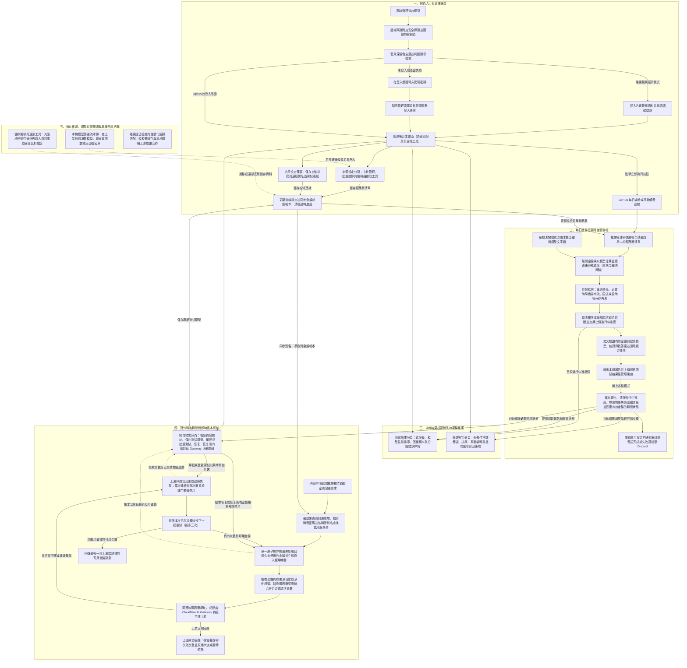
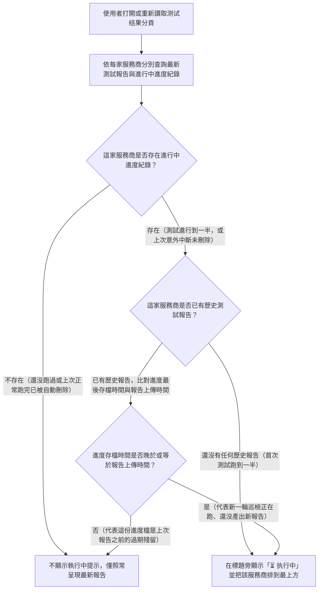
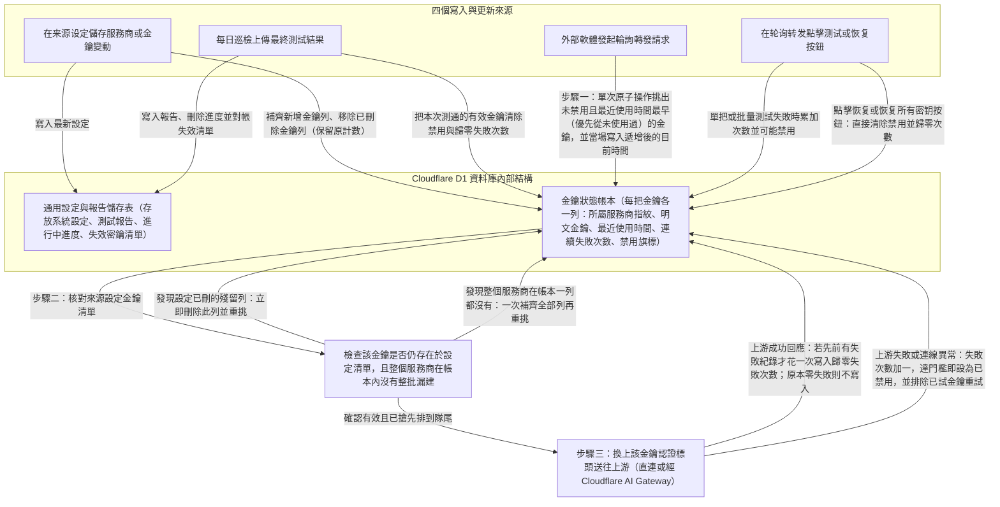
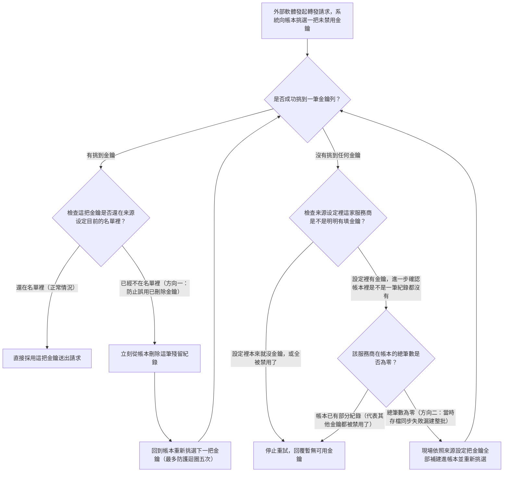

# 專案架構與整體流程說明

本文件專為**第一次接觸本專案**的讀者設計，採由上而下、從宏觀到細節的閱讀順序，全面拆解系統的資料夾分工、跨端運作流程，以及最核心的**「測試儲存邏輯」**、**「D1 帳本流向」**與**「輪詢轉發設計」**：

1. **一句話看懂專案**與**各資料夾內容功能**（精簡定位，不作冗餘逐檔流水帳）。
2. **整體代碼流程圖**：**完全不使用任何函式或變量名稱**，只以畫面上／服務上看得到的名稱與功能實際動作作為名詞。
3. **功能名稱與流程圖名詞對照表**：把流程圖名詞對應回真實功能名稱與跨檔案協作位置。
4. **核心設計深潛**：補上 **D1 關鍵流程圖**、**雙向同步防護流程圖**、**`⏳ 执行中` 判定流程圖**，以及指紋格式、API 清單、JSON vs SQL 優缺點、LRU 挑鑰情境表、標頭淨化、環境變數盤點與各種邊界機制。

---

## 一句話看懂這個專案

這是一個架構在 **Cloudflare Pages** 與 **GitHub Actions** 上的**多服務商 API 金鑰檢測與輪詢轉發平台**：

- **日常巡檢**：在網頁後台維護各家 API 服務商的金鑰與模型清單，由每日自動排程（或手動觸發／本機執行）並發測試「每把金鑰 × 每個模型」，彙整可用金鑰、可用模型、效能延遲、思考能力與失敗原因，並自動對帳失效清單與發送 Discord 通知。
- **對外轉發**：同一份服務商設定只要填上轉發別名，外部軟體就能透過專屬轉發網址輪流使用未禁用的金鑰呼叫上游服務；在前往上游的途中，**僅支援兩種路徑**：**直連該服務商原本填寫的 API 網址**，或**經由唯一整合的 Cloudflare AI Gateway 轉接至該上游並記錄日誌**（並未適配 OpenRouter、Vercel 等其他閘道平台）。轉發期間遇錯會自動累計失敗次數、達門檻禁用並換下一把重試，待下次每日巡檢證實恢復或人工恢復後重新投入輪用。

---

## 一、各資料夾的內容與功能

### 1.1 目錄結構總覽

```text
api-test/
├── .github/workflows/       # GitHub Actions 每日定時與手動巡檢工作流
├── public/                  # Cloudflare Pages 靜態管理介面 ＋ 邊緣後端閘道
├── scripts/                 # 資料庫儲存層（KV → D1）備份、搬移與還原工具
├── tests/                   # 全離線自動化回歸測試套件
├── local_test/              # 本機端的模型上架日篩選與對話實測流水線及廠商快照
├── models_list/             # 整理好的各服務商模型逗號清單參考庫
├── docs/                    # 本架構文件、設計決策紀錄與歷史規劃文件
├── async_test_keys.py       # 核心多金鑰 × 多模型非同步並發檢測腳本
├── package.json / lock      # Node.js 開發預覽、語法檢查、測試與搬移指令入口
├── requirements.txt         # Python 相依套件清單（aiohttp 等）
├── README.md / AGENTS.md    # 部署維運手冊與協作規範
└── .env.example / .gitignore
```

> [!NOTE]
> 本機開發或執行腳本時還會出現已列入 `.gitignore`、不進版控的項目：`.dev.vars`（Wrangler 本機密鑰）、`.wrangler/`（Wrangler 本機模擬 KV 與 D1 SQLite 狀態）、`node_modules/`、`__pycache__/`、`backups/`（含明文金鑰的搬移還原備份檔）、`valid_keys/`（單機測試模式讀取的金鑰目錄）、`checkpoint.json` 與 `async_test_results.json`。

### 1.2 每個資料夾的職責定位

| 資料夾／位置 | 核心內容與實際功能 | 在系統中如何與其他區域連動 |
|---|---|---|
| **根目錄（`/`）** | 放置每日並發測試引擎 [async_test_keys.py](../async_test_keys.py)、Node/Python 設定與指令入口（[package.json](../package.json)、[requirements.txt](../requirements.txt)）及操作手冊（[README.md](../README.md)）。 | 測試引擎連線 `public/` 閘道讀取設定並回傳進度與結果；亦可脫離雲端，改讀 `valid_keys/` 與 `models_list/` 單機運行。 |
| **`.github/workflows/`** | 放置自動化排程檔 [main.yml](../.github/workflows/main.yml)（每天 UTC 00:00 自動跑或手動觸發，最長 90 分鐘、禁止同時重疊多輪）。 | 啟動根目錄的 `async_test_keys.py` 執行巡檢；結束後無論成功失敗，皆向 `public/` 閘道查詢 Discord Webhook 並發送通知。 |
| **`public/`** | 整個線上站台所在（無建置步驟）：包含靜態單頁前端（[index.html](../public/index.html)、[boot.js](../public/boot.js)、[app.js](../public/app.js)、[style.css](../public/style.css)、離線範例 [mock.json](../public/mock.json) 與下拉樣式比較預覽頁 `select-preview.*`）與 Cloudflare Pages 邊緣閘道（[_worker.js](../public/_worker.js)）。 | 對瀏覽器提供 4 個管理分頁與登入認證；對測試引擎提供設定／檢查點／結果 API；對外部軟體提供 `/proxy/{別名}/...` 輪詢轉發與 D1／KV 儲存層抽象。 |
| **`scripts/`** | 放置資料庫搬移工具 [migrate-kv-to-d1.mjs](../scripts/migrate-kv-to-d1.mjs)。 | 透過 `public/` 閘道的儲存維運端點，完成「先落地本機備份 → 寫入 D1 → 逐筆驗證」的升級與 `--restore` 回滾。 |
| **`tests/`** | 放置 3 套全離線測試（[worker.test.mjs](../tests/worker.test.mjs)、[frontend.test.mjs](../tests/frontend.test.mjs)、[migrate-script.test.mjs](../tests/migrate-script.test.mjs)），透過 `npm test` 執行共 53 項檢查。 | 以記憶體 SQLite 與暫時本地 HTTP 伺服器同時驗證 `public/` 前後端與 `scripts/` 搬移安全合約，不碰真實金鑰或外網。 |
| **`local_test/`** | 放置 3 支本機 Python 模型過濾腳本（查上架日 → 實測聊天 → 抽出通過名單）及 `alibaba-cn/`、`nvidia/`、`siliconflow-cn/` 三家快照與結果子目錄。 | 獨立於線上系統之外，協助管理員先把上百個模型篩出近期可用的精簡名單，再貼回網頁設定或收進 `models_list/`。 |
| **`models_list/`** | 放置整理完畢的純文字逗號分隔模型清單（Aliyun、Groq、Moonshot、Nvidia NIM、SiliconFlow）。 | 提供複製貼入網頁「`来源设定`」或本機單機測試的現成清單庫。 |
| **`docs/`** | 放置本架構說明（[architecture.md](./architecture.md)）、持續維護的設計取捨紀錄（`docs/decision-*.md`）、擴充需求規格（[api-test-擴充需求計畫書.md](./api-test-擴充需求計畫書.md)）與早期封存快照（[SPEC-0813.md](./SPEC-0813.md) 等）。 | 記錄各階段演進脈絡與不能輕易破壞的設計約束。 |

---

## 二、整體代碼流程圖

> [!IMPORTANT]
> 本文件內**所有流程圖均僅使用畫面上／服務中看得到的名稱，以及功能本身的實際動作作為名詞**，完全不使用任何函式名稱、變量名稱、資料庫欄位、JSON 鍵名或程式碼識別符。由上往下閱讀即可掌握跨端互動全貌。



---

## 三、功能名稱與流程圖名詞對照表

這張對照表將專案中的**真實功能名稱**與上方總流程圖裡的**名詞**一一對應，標出「哪幾個檔案一起完成這件事」：

| 流程分區 | 系統功能名稱 | 流程圖對應名詞 | 跨檔案負責位置 |
|---|---|---|---|
| 一、入口與後台 | 安全標頭輸出與靜態資源託管 | 邊緣閘道附加安全標頭並回傳靜態網頁 | [public/_worker.js](../public/_worker.js)（所有出口統一加上 CSP 等標頭 ＋ 回傳 `public/` 靜態檔） |
| 一、入口與後台 | 首次繪製前主題與登入提示預載 | 套用深淺色主題並判斷顯示模式 | [public/boot.js](../public/boot.js)（防閃爍）＋ [public/app.js](../public/app.js)（啟動驗證） |
| 一、入口與後台 | `?mock` 離線展示模式 | 載入內建範例資料並跳過密碼驗證 | [public/app.js](../public/app.js) ＋ [public/mock.json](../public/mock.json) |
| 一、入口與後台 | 管理員登入介面與憑證核發 | 在登入畫面輸入管理密碼 ／ 驗證管理密碼並核發瀏覽器登入憑證 | [public/index.html](../public/index.html) ＋ [public/app.js](../public/app.js) ⇄ [public/_worker.js](../public/_worker.js)（無狀態 HMAC Cookie 與 Bearer） |
| 一、入口與後台 | 單頁導覽列、切換主題、登出與「`立即执行`」外連 | 管理後台主畫面（頂部四分頁與全域工具） | [public/index.html](../public/index.html) ＋ [public/app.js](../public/app.js) |
| 一、入口與後台 | 「`来源设定`」與「`应用设定`」互動管理 | `来源设定`分頁… ／ `应用设定`彈窗… | [public/index.html](../public/index.html) ＋ [public/app.js](../public/app.js) ＋ [public/style.css](../public/style.css) |
| 一、入口與後台 | `app_settings` 樂觀鎖寫入與 `key_state` 同步 | 更新後端設定並同步金鑰狀態帳本、清理過時進度 | [public/_worker.js](../public/_worker.js)（設定驗證、版本鎖、D1 同步與清舊進度） |
| 二、批量檢測 | GitHub Actions 每日自動巡檢與通知 | GitHub 每日定時或手動觸發巡檢 ／ 讀取應用設定的通知網址並發送…至 Discord | [.github/workflows/main.yml](../.github/workflows/main.yml) ⇄ [async_test_keys.py](../async_test_keys.py) ＆ [public/_worker.js](../public/_worker.js) |
| 二、批量檢測 | 讀取遠端設定或本機文字檔（Fallback） | 攜帶管理密碼向後台讀取啟用中的服務商清單 ／ 單機測試模式改讀本機金鑰與模型文字檔 | [async_test_keys.py](../async_test_keys.py)（遠端 `GET /api/settings` 或本地讀檔） |
| 二、批量檢測 | 任務佇列、單鑰兩輪、串流降級／重試與熔斷進度上傳 | 展開金鑰乘以模型任務… ／ 並發探測… ／ 偵測權限或餘額錯誤即時熔斷並定期上傳進行中進度 | [async_test_keys.py](../async_test_keys.py) ⇄ [public/_worker.js](../public/_worker.js)（`POST /api/checkpoint`） |
| 二、批量檢測 | 交叉驗證、錯誤詳情去重與結果對帳恢復 | 交叉驗證… ／ 輸出本機報告並上傳最終測試結果… ／ 儲存報告、清除進行中進度、雙向對帳失效密鑰清單並恢復有效金鑰的轉發狀態 | [async_test_keys.py](../async_test_keys.py) ⇄ [public/_worker.js](../public/_worker.js)（`POST /api/results` 觸發三段連動） |
| 三、結果與維護 | 「`测试结果`」展示與跨語言正規化錯誤分組 | `测试结果`分頁：進度條、模型性能排序、回覆樣本與分組錯誤詳情 | [public/app.js](../public/app.js)（平行抓結果與檢查點，正規化邏輯與 [async_test_keys.py](../async_test_keys.py) 同步） |
| 三、結果與維護 | 「`失效密钥`」篩選、排序、編輯交棒與批次刪除 | `失效密钥`分頁：五條件常駐篩選、排序、單筆編輯與批次刪除寫回後端 | [public/app.js](../public/app.js) ⇄ [public/_worker.js](../public/_worker.js)（`GET`/`PUT`/`DELETE /api/dead-keys`） |
| 四、輪詢轉發 | 外部呼叫軟體請求進入與轉發前置驗證 | 外部呼叫軟體攜帶獨立轉發密碼發送請求 ／ 確認專責資料庫環境、驗證轉發密碼並依轉發別名查找啟用服務商 | 外部軟體 ⇄ [public/_worker.js](../public/_worker.js)（`/proxy/{別名}/...`） |
| 四、輪詢轉發 | D1 原子 LRU 選鑰、雙向防線、標頭淨化與 AI Gateway 轉接 | 單一原子操作挑選未禁用且最久未使用的金鑰… ／ 複核金鑰仍在`来源设定`並淨化標頭… ／ 直連該服務商網址，或經由 Cloudflare AI Gateway 轉接至該上游 | [public/_worker.js](../public/_worker.js)（D1 `key_state` ＋ `app_settings` ＋ 上游或唯一 CF AI Gateway 端點） |
| 四、輪詢轉發 | 2xx 成功歸零、非 2xx 累加禁用與最多 3 次換鑰重試 | 上游成功回應… ／ 上游非成功回應或連線失敗… ／ 排除本次已試金鑰後換下一把重試（最多三次） ／ 回傳最後一次上游錯誤或無可用金鑰訊息 | [public/_worker.js](../public/_worker.js) |
| 四、輪詢轉發 | 「`轮询转发`」頁面控制、獨立探測模型與手動恢復 | `轮询转发`分頁：複製轉發網址、保存`测试模型`、單把或批量測試、`恢复`、`恢复所有密钥`與 `Gateway 记录`跳轉 | [public/app.js](../public/app.js) ⇄ [public/_worker.js](../public/_worker.js)（`/api/proxy/*` 系列端點） |
| 五、維運與輔助 | KV → D1 備份、搬移、驗證與還原 | 儲存搬移與還原工具：先落地完整性備份再寫入資料庫並逐筆比對驗證 | [scripts/migrate-kv-to-d1.mjs](../scripts/migrate-kv-to-d1.mjs) ⇄ [public/_worker.js](../public/_worker.js)（`/api/storage/*`） |
| 五、維運與輔助 | 本機模型上架日過濾與對話實測 | 本機模型篩選流水線：查上架日過濾舊模型、聊天實測並抽出逗號名單 | `local_test/` 三支腳本 ＋ `models_list/` |
| 五、維運與輔助 | 語法檢核與全離線自動化測試 | 離線語法檢查與自動化回歸測試：模擬雙儲存與本地模擬上游驗證合約 | [package.json](../package.json) ＋ `tests/` 三支測試檔 |

---

## 四、核心設計深潛

### 4.1 測試與儲存邏輯全貌（指紋、雙儲存、API 清單、傳輸與執行中判定）

#### 一、服務商指紋（Fingerprint）的精確計算格式

前後端與 Python 腳本**不在資料內容裡儲存指紋**，而是在需要索引時三方各自用相同規則現場算出，確保「同一家服務商」在網頁、測試腳本、D1 帳本之間永遠對得上：

```json
{"api_base":"https://api.openai.com/v1","provider_type":"openai"}
```

- **組成規則**：
  1. 先將 `api_base` 去除前後空白與尾端所有斜線 `/`（`https://api.openai.com/v1/` → `https://api.openai.com/v1`）。
  2. 只保留 `api_base` 與 `provider_type` 兩個欄位，且**鍵名順序固定為 `api_base` 在前、`provider_type` 在後**。
  3. 轉成**無空白緊湊 JSON 字串**（Python 端必須明確指定 `separators=(",", ":")`，才能和 JavaScript 的 `JSON.stringify()` 產出完全一致的位元組）。
  4. 對該 UTF-8 字串做 **SHA-256**，輸出 64 字元小寫十六進位雜湊值，即為 `fp`。
- **刻意排除 `keys` 與 `models` 的原因**：增減金鑰、增減模型、修改 `alias` 或 `extra_body` 都**不會改變 `fp`**，因此歷史測試結果（`results:{fp}`）與轉發累計狀態（`key_state.fp`）能無縫延續。只有修改 `api_base` 或 `provider_type`（或刪除該服務商）才會產生新 `fp`，舊 `fp` 殘留的檢查點與測試模型設定會在 `POST /api/settings` 存檔時被自動清除。
- **為什麼介面還有 `fp#序號`（`_uiKey`）？**：因為 `fp` 是確定性雜湊，不是隨機亂數。如果管理員在「`来源设定`」建了**兩張**擁有完全相同 `api_base` 與 `provider_type` 的卡片（例如同端點拆成主帳號與備用帳號兩張卡），它們算出來的 `fp` 會一模一樣！前端「`轮询转发`」選單用 `fp#0`、`fp#1` 區分選項，才不會點第 2 張卡時跳回第 1 張或搞錯明文金鑰配對；而後端「`失效密钥`」對帳因為只認主機域名（`provider_host`），會在讀取 `app_settings` 時把**同域名下所有卡片的 `keys` 取聯集**再比對，防止卡片 A 上傳結果時誤以為卡片 B 的金鑰已被刪掉而當場誤刪。

---

#### 二、KV 與 D1 內容對比：為什麼除了轉發外都用整包 JSON？

環境變數 `STORAGE_BACKEND`（未設定預設為 `d1`，只接受 `d1` 或 `kv`）決定後端儲存方式：

- **KV 模式（`KV_STORE`）**：直接存放 `app_settings`、`checkpoint:{fp}`、`results:{fp}`、`dead_keys` 這 4 種 JSON 鍵；由於 KV 具最終一致性且免費上限每日僅 1,000 次寫入，不建轉發帳本（`/proxy/*` 回 `503`）。
- **D1 模式（`DB`）**：第一次請求時自動建出**兩張資料表**：
  1. **`store` 表**（`k TEXT PRIMARY KEY, v TEXT NOT NULL`）：把 D1 當成鍵值儲存使用，實作與 KV 相同的 `get` / `put` / `delete` / 分頁 `list` 四個操作，因此存放的**就是那完全相同的 4 種 JSON 鍵**。
  2. **`key_state` 關聯表**：專門存放每把轉發金鑰的狀態列（見 4.2 節）。

| 鍵名／資料表 | 寫入端與讀取端 | 具體 JSON 結構／表欄位 |
|---|---|---|
| `app_settings`（JSON） | **寫**：前端「`来源设定`」「`应用设定`」「`轮询转发`（保存模型）」<br>**讀**：前端、Python 腳本、GHA 通知、轉發閘道、失效密鑰對帳 | `{ providers: [...], github_url, discord_webhook_url, proxy_test_models: { [fp]: model }, version: <遞增整數> }`。每個 `provider` 含 `enabled`、`provider_type`、`api_base`、`keys`（`\n` 分隔）、`models`（`,` 分隔）、`extra_body`、`custom_headers`（`[{key, value}]`）、`max_concurrency`，及選填 `alias`、`gateway_provider`。 |
| `checkpoint:{fp}`（JSON） | **寫**：`async_test_keys.py`（每完成 200 筆 ＋ 結束時）<br>**刪**：`POST /api/results` 成功自動刪（或設定刪該卡片時清）<br>**讀**：前端「`测试结果`」 | `{ provider_type, api_base, total_tasks, completed_tasks, dead_keys: [...], results: { [key]: [...] }, saved_at }`。 |
| `results:{fp}`（JSON） | **寫**：`async_test_keys.py` 上傳（後端補 `uploaded_at`）<br>**讀**：前端「`测试结果`」 | `{ provider_type, api_base, uploaded_at, valid_keys: [...], invalid_records: [{ api_key, error_reason, error_code, error_detail }], proven_working_models: [...], failed_models: [...], model_performance: { [model]: { sample_count, content_ever_seen, has_thinking_ratio, avg_ttft, avg_total, timeout_count, total_tested, timeout_rate, answer_verified, sample } } }`。 |
| `dead_keys`（JSON 陣列） | **自動寫**：`POST /api/results` 雙向對帳<br>**人工寫**：前端「`失效密钥`」編輯／批次刪除<br>**讀**：前端「`失效密钥`」 | `[{ id, provider_host, api_key, expired_at, error_code, error_detail, created_at }]`。依 `api_key` 全域去重；`error_detail` 依 `(provider_host, error_code)` 只由同組第一筆持有，離組時透過交棒轉給同組下一筆。 |
| `key_state`（僅 D1 SQL 表） | **寫**：設定同步、轉發選鑰與失敗計數、每日有效恢復、手動測試／恢復、搬移還原<br>**讀**：轉發選鑰、「`轮询转发`」頁面、匯出 | `id`（主鍵）、`fp`、`api_key`、`last_used_at`（毫秒時間戳，新列為 `NULL`）、`fail_count`（預設 0）、`disabled`（0/1）、`updated_at`；建有 `UNIQUE (fp, api_key)` 與索引 `(fp, disabled, last_used_at)`。 |

**為什麼「除了轉發 `key_state` 以外」目前都用整包 JSON，而不是全面改成 SQL 欄位或只更新單一選項？**

| 比較面向 | 現況：設定／結果／失效清單用整包 JSON ＋ 轉發用 SQL 表 | 若全面改為正規化 SQL 多張關聯表 ＋ 單欄位局部更新 |
|---|---|---|
| **KV ⇄ D1 雙後端相容** | **優點**：`store` 模擬 KV 四個操作，讓 `kv` 與 `d1` 模式共用 100% 設定／結果／失效密鑰邏輯，可隨時靠環境變數切換回 KV。 | **缺點**：一旦寫死多表 JOIN／局部 SQL UPDATE，KV 模式就必須重寫或放棄，失去退回 KV 的彈性。 |
| **寫入一致與併發控制** | **優點**：整包 `app_settings` 靠單一 `version` 欄位做樂觀鎖（`409 Conflict`）即可擋掉跨分頁靜默覆蓋；資料量僅數 KB～數十 KB，整包讀寫極單純。 | **缺點**：雖然可以讓「改兩張不同服務商卡片不衝突」，但需設計欄位級鎖定與關聯清理（例如刪服務商要連動清 header 與 model 關聯表），複雜度倍增。 |
| **單筆改刪與查詢效率** | **缺點**：修改或刪除 `dead_keys` 裡的一筆紀錄時必須讀出整包陣列、重組再整包寫回；無法在資料庫端直接用 SQL `WHERE` 過濾 `dead_keys` 或查詢單一服務商設定。 | **優點**：局部更新單筆紀錄不需要整包重寫，資料上萬筆時查詢與篩選延遲更低。 |
| **現況務實判斷** | 對於個人／小團隊管理（幾十家服務商、數百把金鑰，`dead_keys` 上限等於來源不重複金鑰數不會無限膨脹）**現況穩定度與維護成本最划算**；唯有轉發的 `key_state` 需要高頻原子計數，才獨立抽成 SQL 表。 | 僅在未來需要多管理員同時高頻編輯不同服務商、或單站金鑰破萬筆導致 JSON 解析超過 CPU 10ms 上限時才值得重構。 |

---

#### 三、全系統所有 API 端點一覽表（含觸發時機與負責功能）

所有 `/api/*` 均需通過認證（瀏覽器靠 30 天 HttpOnly Cookie `atk_session`；腳本與 CLI 靠 `Authorization: Bearer <ADMIN_PASSWORD>`），唯 `/proxy/{alias}/...` 使用獨立的 `PROXY_PASSWORD`。

| 端點 | 誰呼叫 ／ 何時觸發 | 認證方式 | 實際功能與副作用 |
|---|---|---|---|
| `POST /api/login` | 瀏覽器登入遮罩按「`登入`」 | 明文 `ADMIN_PASSWORD`（Body） | 驗證密碼並簽發 30 天 `atk_session` HttpOnly Cookie（`SameSite=Strict; Path=/api`）。 |
| `POST /api/logout` | 瀏覽器點頂部「`登出`」 | 無（清除 Cookie） | 回傳 `Max-Age=0` 的 `Set-Cookie` 讓瀏覽器清除憑證。 |
| `GET /api/settings` | ① 網頁載入啟動驗證、切換／重載「`来源设定`」與其他分頁初始化<br>② `async_test_keys.py` 啟動巡檢<br>③ GHA 通知步驟 | 管理認證 | 讀取 `app_settings`（包含 `providers`、`github_url`、`discord_webhook_url`、`proxy_test_models`、`version`）。 |
| `POST /api/settings` | **僅前端介面 4 種操作會呼叫**（GHA 不會寫設定）：<br>①「`设定`」彈窗按「`储存`」（只送 `github_url`、`discord_webhook_url`）<br>② 編輯器新增／編輯服務商按「`储存`」<br>③ 卡片按「`删除`」確認<br>④ 勾選多張卡片按「`启用选中`」／「`停用选中`」 | 管理認證（＋選填 `version` 樂觀鎖） | 驗證 `provider_type` 白名單、別名格式與唯一性、每家至少一把 Key；寫回 `app_settings`、版本號 `+1`；清理失效 `proxy_test_models` 與消失服務商的 `checkpoint:{fp}`；D1 模式下觸發 `syncKeyState()` 增刪 `key_state` 列。 |
| `GET /api/results?fp=...` | 前端「`测试结果`」分頁為每家服務商平行拉取 | 管理認證 | 讀取 `results:{fp}` 回傳最新報告（含明文 Key 供一鍵複製）。 |
| `POST /api/results` | `async_test_keys.py` 測完單一服務商時上傳 | 管理認證 | **一次做三件事**：① 寫入 `results:{fp}`（加 `uploaded_at`）並自動刪 `checkpoint:{fp}`、② 觸發 `syncDeadKeysFromResults()` 雙向對帳 `dead_keys`、③ D1 模式下把 `valid_keys` 在 `key_state` 解除禁用與歸零失敗次數。 |
| `GET /api/checkpoint?fp=...` | 前端「`测试结果`」分頁平行檢查是否執行中 | 管理認證 | 讀取 `checkpoint:{fp}` 進度摘要。 |
| `POST /api/checkpoint` | `async_test_keys.py` 每完成 200 筆及該服務商結束時 | 管理認證 | 寫入 `checkpoint:{fp}` 並記錄 `saved_at`。 |
| `DELETE /api/checkpoint?fp=...` | 人工維運／手動清理殘留檢查點（正常跑完由 `POST /api/results` 自動刪） | 管理認證 | 刪除 `checkpoint:{fp}`。 |
| `GET /api/dead-keys` | 切換至「`失效密钥`」分頁或按「`重新读取`」 | 管理認證 | 讀取單一陣列鍵 `dead_keys`。 |
| `PUT /api/dead-keys?id=...` | 「`失效密钥`」單筆編輯視窗按「`储存`」 | 管理認證 | 更新該筆主機／Key／失效日期／錯誤碼；檢查 `api_key` 全域不重複（重複回 409）；跨組變更時自動執行 `error_detail` 舊組交棒與新組去重。 |
| `DELETE /api/dead-keys` | 「`失效密钥`」進入多選模式確認批次刪除（支援 `?id=` 或 Body `{ ids: [...] }`） | 管理認證 | 單次讀改寫批次移除勾選列，並透過 `rebalanceErrorDetail()` 將被刪列持有的 `error_detail` 交棒給同組留存兄弟。（註：已移除 `POST /api/dead-keys`） |
| `GET /api/proxy/state` | 切換至「`轮询转发`」分頁或按「`重新读取`」／批量測試後重整 | 管理認證 | 查詢站台功能開關狀態、`logs_url` 模板與每個服務商的 `key_state` 帳本（**只回傳遮罩金鑰**、失敗次數、最後使用時間、是否禁用與是否已同步）。 |
| `POST /api/proxy/test-model` | 「`轮询转发`」選好測試模型按「`保存模型`」 | 管理認證 | 獨立寫入 `app_settings.proxy_test_models[fp]`（不影響每日巡檢模型清單），並遞增設定 `version`。 |
| `POST /api/proxy/test` | 「`轮询转发`」單張金鑰點「`测试`」或工具列「`测试有效密钥`」／「`测试无效密钥`」依序逐把呼叫 | 管理認證 | 依 `{ id, fp }` 發一筆精簡探測請求（`ping` / `max_tokens: 1`）；失敗呼叫 `recordKeyFailure()` 計數並可禁用（成功目前維持不異動帳本，見 4.2 節）。 |
| `POST /api/proxy/recover` | 「`轮询转发`」單把點「`恢复`」（傳 `{ fp, id }`）或工具列點「`恢复所有密钥`」（傳 `{ fp, all: true }`） | 管理認證（限 D1 模式） | 將指定列（或該服務商所有 `disabled = 1` 列）清為 `disabled = 0, fail_count = 0`。 |
| `GET /api/storage/export` | `migrate-kv-to-d1.mjs` 搬移前或還原前快照（`?source=kv\|d1\|current`） | 管理認證 | 逐頁拉出所有鍵值（上限 `20000` 筆）與 D1 `key_state` 全部列（附 `Cache-Control: no-store`）；`current` 模式在 D1 未綁定時會自動改從 `KV_STORE` 匯出以利救災。 |
| `POST /api/storage/migrate` | `migrate-kv-to-d1.mjs` 執行搬移（傳 `{ confirm: "migrate", dryRun? }`） | 管理認證（需同時綁定 KV 與 D1） | 遍歷 `KV_STORE` 逐頁寫入 D1 `store`（`ON CONFLICT DO NOTHING` 冪等不覆蓋），並依 `providers` 補建 `key_state` 預設列。 |
| `POST /api/storage/restore` | `migrate-kv-to-d1.mjs --restore` 還原備份（傳 `{ confirm: "restore", entries, key_state }`） | 管理認證（需綁定 D1） | 先 upsert 備份裡的 `store` 與 `key_state`，再刪除 D1 內多餘不在備份中的鍵與列，達成精準快照回復。 |
| `* /proxy/{alias}/...` | 外部呼叫軟體送出 AI 請求 | `PROXY_PASSWORD`（`Bearer` / `x-api-key` / `x-goog-api-key`） | D1 原子挑鑰、雙向防線、淨化標頭與參數、轉往直連上游或 Cloudflare AI Gateway、失敗計數禁用與最多 3 次換鑰重試。 |

---

#### 四、「⏳ 执行中」具體在什麼情況會出現？（流程圖與情境拆解）



- **會出現「`⏳ 执行中`」的三種真實情境**：
  1. **全新服務商第一次測試跑到一半**：還沒有任何歷史測試報告，但測試腳本已經滿 `200` 筆任務上傳過第一份進度檔。
  2. **既有服務商正在跑新一輪巡檢**：昨天有一份舊報告，今天新一輪排程正在進行並上傳了進度檔（存檔時間比昨天舊報告更新），此時就會置頂顯示進度與已判死金鑰數，展開下方仍先保留昨天的舊報告參考。
  3. **排程中途被中斷或超時（例如達 90 分鐘上限被取消）**：因為進度檔只在成功上傳最終報告時才會被後端自動刪除，中斷後那份進度檔時間比上次報告新且未被清掉，就會維持顯示「`⏳ 执行中`」（需等下次重跑完成覆蓋刪除，或手動呼叫刪除進度檔）。

---

### 4.2 D1 帳本與目前的「輪詢轉發設計」

#### 一、D1 金鑰狀態帳本與輪詢轉發關鍵流程圖



---

#### 二、為什麼直接用 D1 存「上一把使用的資料」，不用 Redis 或 CF 記憶體／快取？

- **沒有使用 Redis 或 Cloudflare Worker Cache API／記憶體快取**：
  - Worker 記憶體變數只存在單一節點的短暫 isolate 中，全球多節點或冷啟動會遺失；Cache API 具最終一致性且不適合計數；Redis 則需額外託管外部服務與認證。
- **目前唯一狀態來源就是 D1 的 `key_state` 表**：
  - 每次請求透過複合索引 `idx_key_state_pick (fp, disabled, last_used_at)` 用**一條原子 SQL `UPDATE ... RETURNING`** 同時完成挑選與推進時間戳。D1 背後是單一主節點 SQLite 序列處理寫入，能避免同毫秒搶鑰（在正式線上高並發實測序列化強度仍列於 `docs/decision-*.md` 待複驗項目）。
- **「成功後才把失敗次數歸零」寫回比較慢會不會影響下一把挑到的金鑰？**
  - **不會影響「下次會不會重複挑中同一把 Key」**，因為 `last_used_at` 早在「送出請求給上游之前」的挑鑰原子語句就已經寫成最大值排到隊尾了！
  - 而且絕大多數成功請求（原本 `fail_count === 0`）**根本不會寫回 D1**，只有先前曾失敗過 1～2 次的 Key 這次恢復成功時才多做一次 `UPDATE key_state SET fail_count = 0`。該寫入只會在串流開始交還前多增加一次 D1 往返（幾毫秒）；唯極端情況下若在這幾毫秒內剛好輪完一圈又有請求失敗到同一把 Key，才可能依舊次數多計 1 次。

---

#### 三、LRU 挑鑰各種情境一覽（第一次、部分用過、全部用過）

挑鑰語句的核心條件為：`WHERE fp = ? AND disabled = 0 [AND id NOT IN (本次已試)] ORDER BY last_used_at ASC, id ASC LIMIT 1`，並且在 SQLite 中 `NULL` 在升冪排序永遠排在所有數字之前（`NULLS FIRST`）。

| 情境 | 各把金鑰目前的 `last_used_at` ／ `disabled` | 這次會挑中哪一把？ | 挑中後發生的時間戳變化 |
|---|---|---|---|
| **1. 全部剛建立、第一次使用** | A (`NULL`, 0), B (`NULL`, 0), C (`NULL`, 0) | 同為 `NULL`，依寫入順序 `id ASC` 挑 **A** | A 立刻變成 `MAX(now, 0 + 1)` 排到隊尾；第 2 次請求就會挑 **B**，第 3 次挑 **C**。 |
| **2. 部分用過、部分沒用過（含新加的金鑰）** | A (`1700001000`, 0), B (`NULL`, 0), C (`1700002000`, 0) | `NULL` 最小，永遠優先挑沒用過的 **B** | 新加入的金鑰會優先走完一輪，之後大家都有時間戳。 |
| **3. 所有有效金鑰都用過** | A (`1700001000`, 0), B (`1700003000`, 0), C (`1700002000`, 0) | 挑數字最小（最久之前用過）的 **A** | A 變成 `MAX(now, 1700003000 + 1)`，下次就會挑 C (`1700002000`) → B (`1700003000`)，精準輪流。 |
| **4. 存在已被禁用的金鑰** | A (`NULL`, `disabled=1`), B (`1700009000`, 0) | `WHERE disabled = 0` 直接排除 A，只會挑 **B** | 無論禁用的金鑰時間戳多小或為 `NULL`，都不會再被選用。 |
| **5. 同一毫秒內連續來兩筆請求、或同筆失敗重試** | 第 1 次挑走 A 時瞬間將 A 設為 `目前最大值 + 1` | 重試迴圈帶 `id NOT IN (A)` 且時間戳已更新，改挑 **B** | 即使系統時鐘停在同一毫秒，`全域最大值 + 1` 也保證每把時間嚴格遞增，不會互撞。 |

---

#### 四、雙向同步防護在防什麼意外？具體流程圖

平時你在「`来源设定`」按「`储存`」時，後端就會順手增刪帳本列。但為了「設定存檔成功後不因帳本同步失敗而整包回滾」，兩者之間沒有跨儲存交易鎖；萬一同步當下失敗或資料不同步，就會出現**兩種脫節方向**：
- **方向一（設定已刪、帳本還留著）**：避免把管理員已經刪掉／外洩停用的金鑰繼續送給上游！
- **方向二（設定有金鑰、帳本卻一筆都沒有）**：避免新建立或同步漏掉整批時，外部請求一進來就挑不到鑰匙而全部 503 失敗！

這道檢查**只在真正轉發挑鑰當下執行**：



---

#### 五、兩條轉發路徑（直連 vs 唯一 Cloudflare AI Gateway）與實務注意事項

| `provider_type` | 服務商設定範例（`api_base` / `alias` / `gateway_provider`） | 外部軟體呼叫網址 | 直連模式打出的真實網址 | Cloudflare AI Gateway 模式打出的真實網址 |
|---|---|---|---|---|
| **openai** | `https://api.openai.com/v1`<br>`alias: oai`、`slug: oai-gw` | `POST https://<站台>/proxy/oai/chat/completions` | `https://api.openai.com/v1/chat/completions` | `https://gateway.ai.cloudflare.com/v1/<帳號>/<gateway>/custom-oai-gw/chat/completions` |
| **gemini** | `https://generativelanguage.googleapis.com/v1beta`<br>`alias: gem`、`slug: gem-gw` | `POST https://<站台>/proxy/gem/models/gemini-2.5-pro:streamGenerateContent?alt=sse` | `https://generativelanguage.googleapis.com/v1beta/models/gemini-2.5-pro:streamGenerateContent?alt=sse` | `https://gateway.ai.cloudflare.com/v1/<帳號>/<gateway>/custom-gem-gw/models/gemini-2.5-pro:streamGenerateContent?alt=sse` |
| **anthropic** | `https://api.anthropic.com/v1`<br>`alias: ant`、`slug: ant-gw` | `POST https://<站台>/proxy/ant/messages` | `https://api.anthropic.com/v1/messages` | `https://gateway.ai.cloudflare.com/v1/<帳號>/<gateway>/custom-ant-gw/messages` |

- **Cloudflare AI Gateway 後台實際只需設定什麼？**：**完全不需要把各家 API Key 填進 Cloudflare AI Gateway！** 你只需要在 Cloudflare AI Gateway Dashboard 建立一個 Custom Provider，設定它的 `slug` 和 `base_url`（填該服務商的 `api_base`）即可；真實金鑰一直都只留在你自己的站台，由 Worker 挑完金鑰再把認證標頭送進 AI Gateway 轉傳。
- **為什麼目前保留「直連退回」模式？與「測試按鈕」的現況**：
  - 目前只要沒填 `gateway_provider` 或缺 Gateway 環境變數，轉發就會退回直連 `api_base`（`docs/api-test-擴充需求計畫書.md` 這樣設計是為了讓未接 Gateway 的站台與離線測試仍可做金鑰輪詢）。但缺點很明確：**直連模式下看不到請求日誌**（本專案不自建紀錄表），而且目前連「`轮询转发`」的單把「`测试`」按鈕也一起走了 `upstreamFor()`（有設 Gateway 時連測試按鈕也會過 Gateway，只有 `async_test_keys.py` 每日巡檢才固定直連）。若日後確定外部呼叫一律強制過 AI Gateway 才留紀錄、且測試按鈕固定直連測 Key 本身，將兩條路徑拆開即可。
- **關於 `alias`（轉發別名）與 `gateway_provider`（slug）**：兩者之所以拆成兩個欄位，僅為支援「多個不同 `alias` 共用 Gateway 同一個 Custom Provider」或「用是否填寫 `gateway_provider` 當作是否經過 Gateway 的開關」。若在單站台固定都走 AI Gateway 且 slug 與別名命名相同，直接讓 slug 預設沿用 `alias` 可省下一個填寫欄位。

---

#### 六、四層標頭淨化管線、`cf-aig-max-attempts: 1` 與 `cf-aig-metadata` 用途

1. **第一層（剝除危險／洩漏標頭）**：先移除跳躍式標頭（`host`、`connection`、`content-length`、`content-encoding`、`transfer-encoding` 等）、Cloudflare 與代理來源 IP 標頭（`cf-connecting-ip`、`cf-ray`、`x-forwarded-for`、`x-real-ip` 等）、來訪端 `Cookie`、所有呼叫端自帶的 `cf-aig-*`（防偽造）以及呼叫端本身的認證標頭。
   > [!NOTE]
   > 剝除邊緣標頭邏輯目前是以離線 HTTP 測試與早先對 Worker 的 `fetch` 探測驗證（未剝除時確實會透傳）；**經過真實 Cloudflare AI Gateway 後上游實測收到的標頭、`cf-aig-metadata` 篩選與日誌深連結行為，目前仍列為尚未於正式環境實測確認項目**。
2. **第二層（換上協議認證標頭）**：依 `provider_type` 填入該把金鑰的正確認證標頭（見 4.3 節與 Python 端比對表）。
3. **第三層（套用 `custom_headers`）**：放於協議認證之後設定，讓服務商自訂標頭能覆蓋預設認證或 `User-Agent`。
4. **第四層（注入 Cloudflare AI Gateway 控制標頭，僅 Gateway 模式）**：
   - `cf-aig-authorization`: `Bearer <AI_GATEWAY_TOKEN>`（驗證此 Gateway 通道）。
   - `cf-aig-skip-cache: true`：停用 Gateway 回應快取，以免重播舊快取造成輪詢健康度失真。
   - `cf-aig-max-attempts: 1`：**關閉 AI Gateway 內建的自動重試**。原因：如果讓 Gateway 自行重試，它只會拿著**同一把已經壞掉的金鑰**對上游連打好幾次，卻還不回頭讓 Worker 換下一把金鑰；設為 `1` 才能把「這把失敗就立刻換下一把不同金鑰重試」的控制權完全留給 Worker 迴圈。
   - `cf-aig-request-timeout`: 等待上游回應的時間限制。
   - `cf-aig-metadata`: 寫入 `{"key":"sk-a-wxyz","provider":"別名"}`。**這個欄位不是給 Pages 或 D1 看的，而是專門送給 Cloudflare AI Gateway 寫進 Dashboard 日誌的標籤**（Gateway 會截收所有 `cf-aig-*` 標頭而不會轉給 OpenAI 等上游）。當你點擊頁首「`Gateway 记录 ↗`」去查錯時，就能用 `provider` 或 `key` 標籤找出「究竟是哪一把金鑰、哪一家服務商出錯」；目前實作附帶了一個防呆：`ascii.length < 16` 時縮為 `a***z`（原意是怕不到 16 字元的測試密碼取前 4 後 4 等於明文外洩，但對一般 30+ 字元的 API Key 屬於很少觸發的防禦分支）。

- **請求體與超時控制**：`GET`/`HEAD` 不帶請求體；`Content-Type: application/json` 且有合法 `extra_body` 時才淺合併覆蓋頂層鍵，其餘保持原始位元組；`AbortController` 僅控管等待上游回應標頭（預設 `120000ms`），拿到標頭立即取消計時器以放行長串流；非 2xx 回應一律計失敗 `+1` 並排除已試 `id` 換鑰重試（預設最多重試 3 次＝最多試 4 把）。

---

#### 七、轉發金鑰狀態轉換與測試／恢復權責對照

| 觸發事件 | `last_used_at` 變化 | `fail_count` 變化 | `disabled` 變化 | 現行實作原因與備註 |
|---|---|---|---|---|
| **外部轉發選中並成功（2xx）** | 挑鑰當下推進至最新最大值 | 若原本 `> 0` 則歸 `0`；原本為 `0` 不寫入 | 維持 `0` | 省下每次正常請求的歸零寫入；重設偶發失敗紀錄。 |
| **外部轉發失敗（非 2xx／異常）** | 挑鑰當下已推進 | `+ 1` | 累計 `>= 門檻`（預設 3）時設為 `1` | 連續異常達門檻即隔離，避免後續請求繼續打壞鑰。 |
| **「`轮询转发`」手動單把／批量測試失敗** | **不變** | `+ 1` | 累計 `>= 門檻` 時設為 `1` | 讓手動即時測試也能把壞掉的金鑰揪出來隔離。 |
| **「`轮询转发`」手動單把／批量測試成功** | **不變** | **不變（現況）** | **維持現狀（現況不解除禁用）** | 現行設計是為避免單純 `"ping"` 按鈕繞過門檻，將恢復限定在每日巡檢與「`恢复`」鈕；但實際操作上會出現「測通卻仍顯示已失效」的視覺落差（目前待評估改為測試成功即順便歸零與解禁）。 |
| **每日巡檢 `POST /api/results` 列入 `valid_keys`** | **不變** | 歸 `0` | 解除為 `0` | 每日完整測試通過後自動恢復帳本狀態。 |
| **「`轮询转发`」點擊「`恢复`」或「`恢复所有密钥`」** | **不變** | 歸 `0` | 解除為 `0` | 管理員手動立即恢復單把或該服務商全部已禁用金鑰。 |

---

### 4.3 環境變數盤點、跨端一致性與維運細節

#### 一、目前環境變數與資源綁定總盤點（哪些必須留、哪些其實可簡化）

| 設定名稱 | 存放處 ／ 用途 | 是否必須留在環境變數 ／ 簡化評估 |
|---|---|---|
| `DB` / `KV_STORE` | Pages Functions 資源綁定（D1 與 KV） | **必須**：基礎設施綁定只能於 Cloudflare Dashboard 設定。 |
| `STORAGE_BACKEND` | Pages 環境變數（預設 `d1`，或 `kv`） | **必須**：後端連去讀資料庫前就得先知道要讀哪一種儲存引擎。 |
| `ADMIN_PASSWORD` | Pages 環境變數 ＋ GHA Secret | **必須**：登入門禁與 Cookie 簽章密鑰，不可存入後台資料庫自舉。 |
| `PAGES_URL` | 僅 GHA Secret | **必須**：GHA 啟動時要知道該打哪個站台網址。 |
| `PROXY_PASSWORD` | Pages 環境變數（嚴格不可與 `ADMIN_PASSWORD` 相同） | **建議留變數（可選放前端）**：留在環境變數可免去進入 `app_settings` JSON；但若希望方便隨時輪換而不重部署，也可移入後台「`设定`」。 |
| `AI_GATEWAY_TOKEN` | Pages 環境變數 | **建議留變數**：屬存取 Gateway 的機密權杖，留在伺服端較安全。 |
| `AI_GATEWAY_ACCOUNT_ID`<br>`AI_GATEWAY_ID` | Pages 環境變數 | **可合併簡化**：整份程式裡這兩個變數**只用來拼出固定前半段網址** `https://gateway.ai.cloudflare.com/v1/{account}/{gateway}`，無任何其他用途；合併為單一網址變數（或放前端設定）即可減少欄位。 |
| `AI_GATEWAY_LOGS_URL` | Pages 環境變數（`{provider}` / `{key}` 模板） | **可搬入前端設定**：僅為一條儀表板超連結模板，不涉及機密。 |
| `PROXY_FAIL_THRESHOLD` (預設 3)<br>`PROXY_MAX_RETRIES` (預設 3)<br>`PROXY_UPSTREAM_TIMEOUT_MS` (預設 120000) | Pages 環境變數 | **適合搬入前端「`设定`」**：這三個純數值調校參數目前寫死在環境變數會逼得每次調整門檻都必須重新部署 Pages，改存進 `app_settings` 並保留程式預設值會更便於管理。 |

---

#### 二、Python 巡檢端與 Worker 轉發端的協議認證比對

| `provider_type` | `async_test_keys.py`（巡檢出站） | `_worker.js`（轉發出站） | `_worker.js`（對外部呼叫軟體入站驗證 `PROXY_PASSWORD`） |
|---|---|---|---|
| **openai** | `Authorization: Bearer <key>` | `Authorization: Bearer <key>` | 同時支援呼叫端於 `Authorization: Bearer`、`x-api-key` 或 `x-goog-api-key` 任一標頭傳入 `PROXY_PASSWORD` |
| **gemini** | `x-goog-api-key: <key>` | `x-goog-api-key: <key>` | 同上 |
| **anthropic** | `x-api-key: <key>`<br>`anthropic-version: 2023-06-01` | `x-api-key: <key>`<br>`anthropic-version: 2023-06-01` | 同上 |
| **自定義覆蓋** | 皆於建完上述標頭後套用 `custom_headers` | 皆於建完上述標頭後套用 `custom_headers` | 入站密碼比對不套用 `custom_headers` |

兩邊針對出站認證標頭與 `custom_headers` 後置覆蓋完全對齊（差別僅在 Python 測試固定帶 `User-Agent: claude-code/2.1.152`，而 Worker 轉發預設透傳呼叫端 `User-Agent`）；兩套分別跑在 GitHub Actions Python 與 Cloudflare Edge JavaScript，各司其職並無功能重複。

---

#### 三、其餘重要跨端規則精要

- **前端多處「複製按鈕」共用狀況**：全站四個分頁裡所有複製 Key、模型或無效分組的按鈕，底層**全數共用 [`copyText()`](../public/app.js)**（優先 Clipboard API，失敗自動退回建立隱藏 `textarea` ＋ `execCommand("copy")`，圖示鈕切綠色打勾 1.5 秒、文字鈕顯示「`已复制!`」1.5 秒）。**唯獨「`轮询转发`」的整行轉發網址列**（`copyProxyUrl()`）雖然底層一樣呼叫 `copyText(url, null)` 複製，但為了不觸發按鈕停用樣式而將該列文字本身暫時替換成「`已复制`」1.2 秒。此外，「`轮询转发`」卡片能點複製按鈕是因為前端用 `maskKey()` 將 `/api/proxy/state` 的遮罩結果與自己讀到的 `/api/settings` 明文清單比對配對（後端 `/api/proxy/state` 絕不吐出明文金鑰）。
- **嚴格 CSP 與安全防線**（`public/_worker.js` ＋ `boot.js` ＋ `app.js`）：因 Cloudflare `_headers` 對 Pages Functions 無效，安全標頭全數於 `public/_worker.js` 出口統一附加；`script-src 'self'` 迫使防閃爍主題腳本獨立為 `boot.js`；`style-src 'self'` 禁止任何 `style=""`；`connect-src` 僅放行自身與 `discord.com`／`discordapp.com`（供設定視窗測試通知）。
- **測試引擎關鍵細節**（`async_test_keys.py` ＋ `app.js`）：
  - 單金鑰服務商連測 2 輪（間隔 `2.0` 秒，首輪遇 `401`/`403`/餘額/配額熔斷即跳過第二輪）；`checkpoint` 續跑只略過已滿額成功組合並預載 `401`/`403` 死鑰；預設並發 `2`、`TTFT_TIMEOUT = 5s`、`TOTAL_TIMEOUT = 20s`、`MAX_OUTPUT_TOKENS = 512`。
  - 串流失敗且非 `(401, 403, 404, 400, 429, 408)` 自動降級非串流；首次遇 `429` 或 `408` 等 `2` 秒再試一次；只要有正文或思考內容就算成功。先對完整文字檢核 `"323"` 決定 `answer_verified`，再各自對 `content` 與 `thinking` 做頭尾各 `1024` 字元（上限 `2048`）的冪等裁切；錯誤本文先完整解析 JSON 再逐欄限長 512 字元。
  - Python `normalize_message()` 與 JS `normalizeMessage()` 嚴格同步（避開 `\b`、`\d` 與 lookbehind），並只於每組第一筆保存 `error_detail` 省空間。
- **失效密鑰對帳、交棒與介面統一**（`_worker.js` ＋ `app.js`）：`POST /api/results` 觸發雙向對帳，同時清除已在來源設定移除（同域名卡片取聯集）或本輪測通的 Key；跨組換碼、編輯或批次刪除離組時透過 `rebalanceErrorDetail()` 交棒 `error_detail`；前端統一以 `別名 || host` 顯示「供应商」，表格採桌機 6+`***`+3／手機 6+`***`+1 響應式遮罩，桌機下拉選單漸進強化為固定寬度平面彈窗。
- **KV → D1 安全搬移順序與離線保障**（`scripts/migrate-kv-to-d1.mjs` ＋ `local_test/` ＋ `tests/`）：舊站台升級順序為「綁定 `DB`（保留 `KV_STORE`）→ 設 `STORAGE_BACKEND=kv` 部署 → `npm run migrate`（強制先存 `0600` 校驗備份，限 `20000` 筆，冪等搬移＋比對驗證）→ 改設 `d1` 部署」。開發品質由 `npm run check` 與 `npm test`（53 項全離線測試）驗證。
