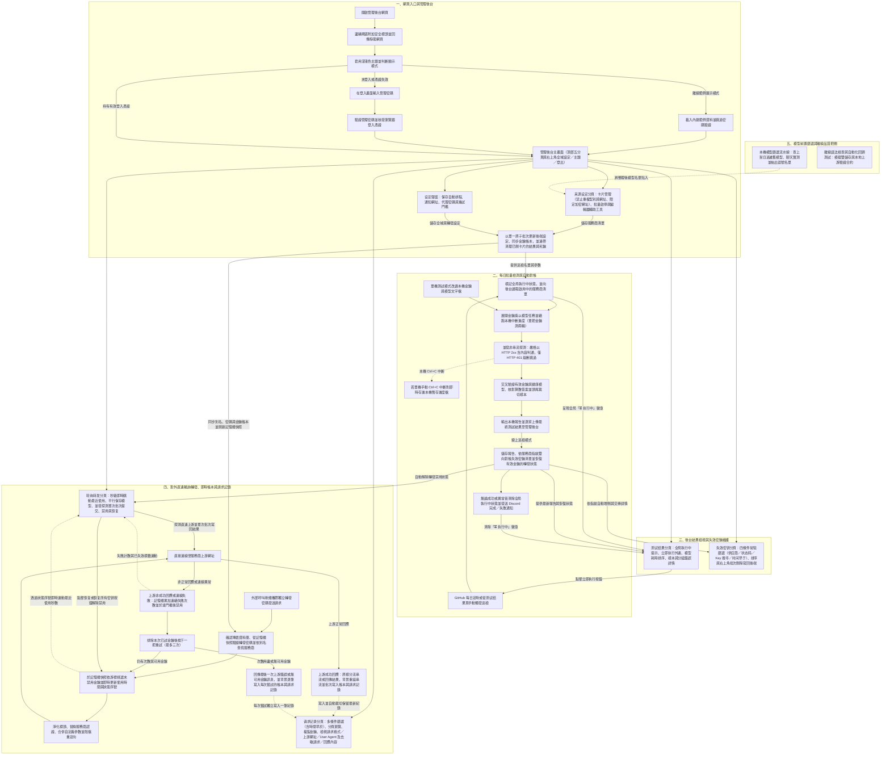
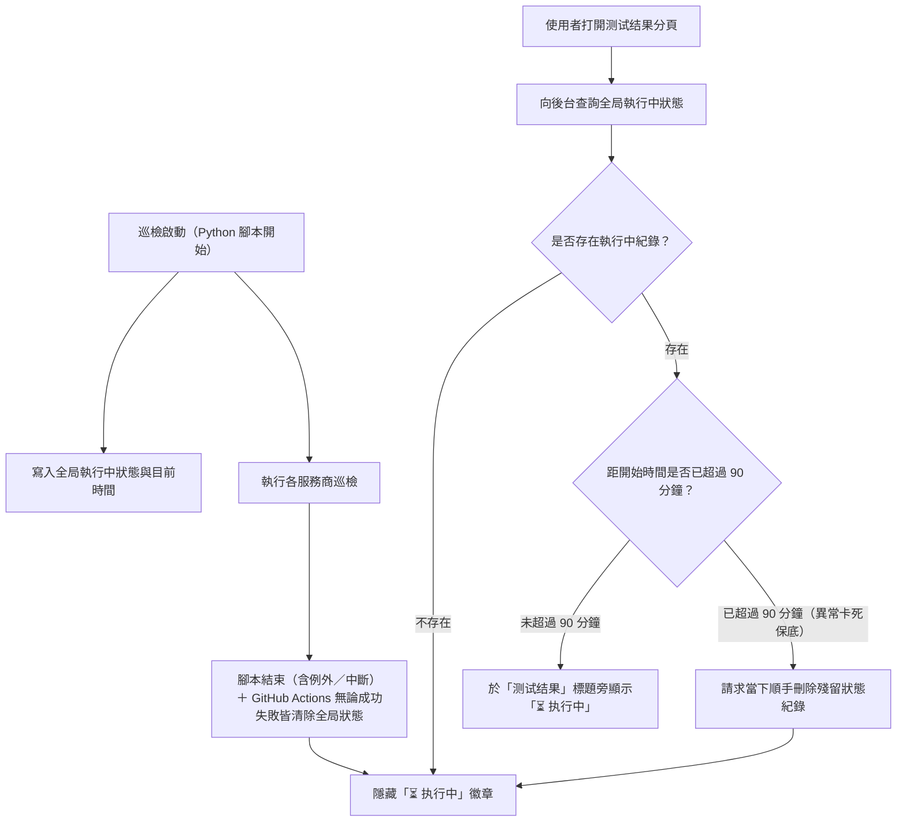
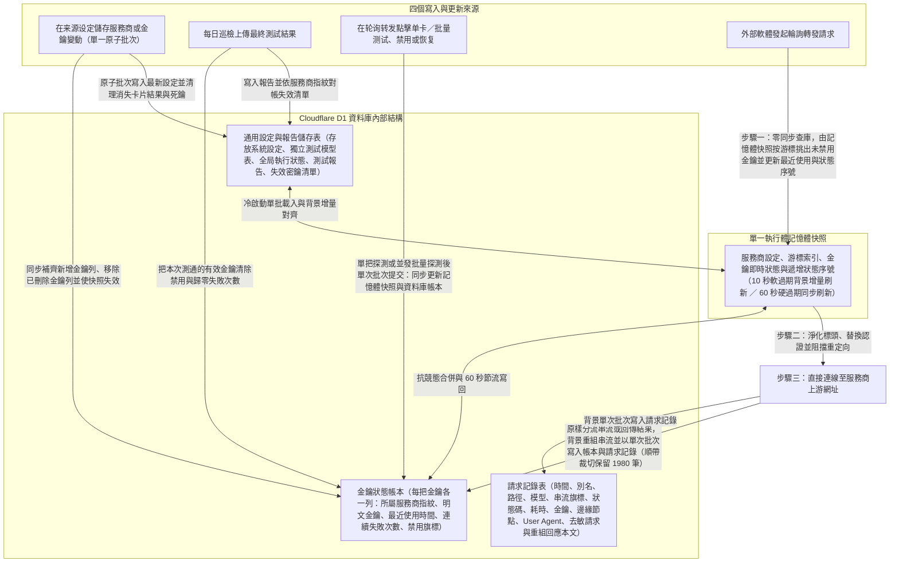

# 專案架構與整體流程說明

本文件專為**第一次接觸本專案**的讀者設計，採由上而下、從宏觀到細節的閱讀順序，全面拆解系統的資料夾分工、跨端運作流程，以及最核心的**「測試儲存邏輯」**、**「D1 帳本流向」**與**「輪詢轉發設計」**：

1. **一句話看懂專案**與**各資料夾內容功能**（精簡定位，不作冗餘逐檔流水帳）。
2. **整體代碼流程圖**：**完全不使用任何函式或變量名稱**，只以畫面上／服務上看得到的名稱與功能實際動作作為名詞。
3. **功能名稱與流程圖名詞對照表**：把流程圖名詞對應回真實功能名稱與跨檔案協作位置。
4. **核心設計深潛**：補上 **D1 關鍵流程圖**、**雙向同步防護流程圖**、**`⏳ 执行中` 判定流程圖**，以及指紋格式、API 清單、JSON vs SQL 優缺點、記憶體快照游標輪詢、標頭淨化、SSE 串流重組日誌、環境變數盤點與各種邊界機制。

---

## 一句話看懂這個專案

這是一個架構在 **Cloudflare Pages** 與 **GitHub Actions** 上的**多服務商 API 金鑰檢測、直連輪詢轉發與完整請求日誌平台**：

- **日常巡檢**：在網頁後台維護各家 API 服務商的金鑰與模型清單，由每日自動排程（或「`测试结果`」頁手動觸發／本機執行）直接向各服務商 `api_base` 發送純非串流請求並發測試「每把金鑰 × 每個模型」，彙整可用金鑰、可用模型、總耗時、思考能力與失敗原因，並依服務商指紋自動對帳失效清單與發送 Discord 通知。
- **對外直連轉發與請求記錄**：同一份服務商設定只要填上轉發別名，外部軟體與「`轮询转发`」手動測試即可直接向服務商 `api_base` 發送請求（不再依賴 Cloudflare AI Gateway）。Worker 以單一執行體記憶體快照搭配游標輪流挑選未禁用金鑰、秒級即時刷新「最近使用」，並透過 `response.body.tee()` 與背景 `ctx.waitUntil` 零首字節阻塞重組 SSE 串流與寫入 D1 `proxy_logs`（保留最新 1,980 筆，供第五分頁「`请求记录`」檢索與排錯）。轉發期間遇錯會自動累計失敗次數、達門檻禁用並換下一把重試；待手動測試成功、人工按恢復或下次每日巡檢證實恢復後重新投入輪用。

---

## 一、各資料夾的內容與功能

### 1.1 目錄結構總覽

```text
api-test/
├── .github/workflows/       # GitHub Actions 每日定時與手動巡檢工作流
├── public/                  # Cloudflare Pages 靜態管理介面 ＋ 邊緣後端閘道
├── scripts/                 # Worker 分段拼接與全專案 JS 語法檢核腳本
├── tests/                   # 全離線自動化回歸測試套件（Node + Python）
├── local_test/              # 本機端的模型上架日篩選與對話實測流水線及廠商快照
├── models_list/             # 整理好的各服務商模型逗號清單參考庫
├── docs/                    # 本架構文件、設計決策紀錄與歷史規劃文件
├── async_test_keys.py       # 核心多金鑰 × 多模型非同步並發檢測腳本
├── package.json / lock      # Node.js 開發預覽、語法檢查與測試指令入口
├── requirements.txt         # Python 相依套件清單（aiohttp 等）
├── README.md / AGENTS.md    # 部署維運手冊與協作規範
└── .env.example / .gitignore
```

> [!NOTE]
> 本機開發或執行腳本時還會出現已列入 `.gitignore`、不進版控的項目：`.dev.vars`（Wrangler 本機密鑰）、`.wrangler/`（Wrangler 本機模擬 KV 與 D1 SQLite 狀態）、`node_modules/`、`__pycache__/`、`valid_keys/`（單機測試模式讀取的金鑰目錄）、`checkpoint.json` 與 `async_test_results.json`。

### 1.2 每個資料夾的職責定位

| 資料夾／位置 | 核心內容與實際功能 | 在系統中如何與其他區域連動 |
|---|---|---|
| **根目錄（`/`）** | 放置每日並發測試引擎 [async_test_keys.py](../async_test_keys.py)、Node/Python 設定與指令入口（[package.json](../package.json)、[requirements.txt](../requirements.txt)）及操作手冊（[README.md](../README.md)）。 | 測試引擎連線 `public/` 閘道讀取設定並回傳進度與結果；亦可脫離雲端，改讀 `valid_keys/` 與 `models_list/` 單機運行。 |
| **`.github/workflows/`** | 放置自動化排程檔 [main.yml](../.github/workflows/main.yml)（每天 UTC 00:00 自動跑或手動觸發，最長 90 分鐘、禁止同時重疊多輪）。 | 啟動根目錄的 `async_test_keys.py` 執行巡檢；結束時透過 `if: always()` 清除全域執行中狀態並向 `public/` 閘道查詢 Discord Webhook 發送通知。 |
| **`public/`** | 整個線上站台所在：包含靜態單頁前端（[index.html](../public/index.html)、[boot.js](../public/boot.js)、[app.js](../public/app.js) 入口與分段邏輯 [js/](../public/js/)、[style.css](../public/style.css) 及其分段樣式 `style-*.css`、離線範例 [mock.json](../public/mock.json)、未匹配路徑錯誤頁 [404.html](../public/404.html)）與 Cloudflare Pages 邊緣閘道 `_worker.js`。 | 對瀏覽器提供 5 個管理分頁（`来源设定`、`测试结果`、`失效密钥`、`轮询转发`、`请求记录`）與登入認證；對測試引擎提供設定／全局執行狀態／結果 API；對外部軟體提供 `/proxy/{別名}/...` 直連輪詢轉發與 D1／KV 儲存層抽象。`_worker.js` 為生成檔不入庫：部署時由 Pages 的 build command（`npm run build`）從 `src/` 拼接生成。 |
| **`src/`** | 放置 `public/_worker.js` 的 13 個分段原始碼（`entry`／`storage`／`auth`／`utils`／`settings`／`settings-handlers`／`results`／`run-status`／`dead-keys`／`proxy-state`／`proxy-logs`／`proxy`／`proxy-handlers`）。 | 由 `scripts/build-worker.mjs` 依固定順序拼接回單一 `public/_worker.js`；拼接順序不可改動（頂層 `const` 宣告按原檔順序求值）。生成檔不入庫（`.gitignore`），本地 `npm run dev`／`npm test` 會以前置步驟自動生成，部署由 Pages 的 build command 生成。 |
| **`scripts/`** | 放置 Worker 拼接腳本 [build-worker.mjs](../scripts/build-worker.mjs)（把 `src/*.js` 依序組回 `public/_worker.js`）與語法檢查 [check-syntax.mjs](../scripts/check-syntax.mjs)。 | 對全專案 34 個 JS 檔執行語法把關，並生成部署用的單一 `_worker.js`。 |
| **`tests/`** | 放置全離線測試（[worker.test.mjs](../tests/worker.test.mjs) 與 [frontend.test.mjs](../tests/frontend.test.mjs) 透過 `npm test` 執行 75 項 JS／Worker 檢查；另有 Python 測試 [test_async_engine.py](../tests/test_async_engine.py) 驗證離線巡檢與 `checkpoint.json` 續跑邏輯）。 | 以記憶體 SQLite、模擬 `aiohttp` 與暫時本地 HTTP 伺服器同時驗證前後端、儲存同步、記憶體快照、SSE 重組日誌與測試引擎合約，不碰真實金鑰或外網。 |
| **`local_test/`** | 放置 3 支本機 Python 模型過濾腳本（查上架日 → 實測聊天 → 抽出通過名單）及 `alibaba-cn/`、`nvidia/`、`siliconflow-cn/` 三家快照與結果子目錄。 | 獨立於線上系統之外，協助管理員先把上百個模型篩出近期可用的精簡名單，再貼回網頁設定或收進 `models_list/`。 |
| **`models_list/`** | 放置整理完畢的純文字逗號分隔模型清單（Aliyun、Groq、Moonshot、Nvidia NIM、SiliconFlow）。 | 提供複製貼入網頁「`来源设定`」或本機單機測試的現成清單庫。 |
| **`docs/`** | 放置本架構說明（[architecture.md](./architecture.md)）、持續維護的設計取捨紀錄（`docs/decision-*.md`）、擴充需求規格（[api-test-擴充需求計畫書.md](./api-test-擴充需求計畫書.md)）與早期封存快照（[SPEC-0813.md](./SPEC-0813.md) 等）。 | 記錄各階段演進脈絡與不能輕易破壞的設計約束。 |

---

## 二、整體代碼流程圖

> [!IMPORTANT]
> 本文件內**所有流程圖均僅使用畫面上／服務中看得到的名稱，以及功能本身的實際動作作為名詞**，完全不使用任何函式名稱、變量名稱、資料庫欄位、JSON 鍵名或程式碼識別符。由上往下閱讀即可掌握跨端互動全貌。



---

## 三、功能名稱與流程圖名詞對照表

這張對照表將專案中的**真實功能名稱**與上方總流程圖裡的**名詞**一一對應，標出「哪幾個檔案一起完成這件事」：

| 流程分區 | 系統功能名稱 | 流程圖對應名詞 | 跨檔案負責位置 |
|---|---|---|---|
| 一、入口與後台 | 安全標頭輸出與靜態資源託管 | 邊緣閘道附加安全標頭並回傳靜態網頁 | [public/_worker.js](../src/entry.js)（所有出口統一加上 CSP 等標頭 ＋ 回傳 `public/` 靜態檔） |
| 一、入口與後台 | 首次繪製前主題與登入提示預載 | 套用深淺色主題並判斷顯示模式 | [public/boot.js](../public/boot.js)（防閃爍）＋ [public/app.js](../public/app.js)（啟動驗證） |
| 一、入口與後台 | `?mock` 離線展示模式 | 載入內建範例資料並跳過密碼驗證 | [public/app.js](../public/app.js) ＋ [public/mock.json](../public/mock.json) |
| 一、入口與後台 | 管理員登入介面與憑證核發 | 在登入畫面輸入管理密碼 ／ 驗證管理密碼並核發瀏覽器登入憑證 | [public/index.html](../public/index.html) ＋ [public/app.js](../public/app.js) ⇄ [public/_worker.js](../src/entry.js)（無狀態 HMAC Cookie 與 Bearer） |
| 一、入口與後台 | 單頁導覽列、切換主題與登出 | 管理後台主畫面… | [public/index.html](../public/index.html) ＋ [public/app.js](../public/app.js) |
| 一、入口與後台 | 「`来源设定`」與「`设定`」彈窗管理 | `来源设定`分頁… ／ `设定`彈窗… | [public/index.html](../public/index.html) ＋ [public/app.js](../public/app.js) ＋ [public/style.css](../public/style.css) |
| 一、入口與後台 | `app_settings` 原子寫入與 D1 `db.batch()` 同步 | 以單一原子批次更新後端設定、同步金鑰帳本，並連帶清理已刪卡片的結果與死鑰 | [public/_worker.js](../src/entry.js)（重複卡片阻擋、版本鎖、D1 原子批次寫入） |
| 二、批量檢測 | GitHub Actions 每日自動巡檢與 `if: always()` 清理通知 | GitHub 每日定時或…手動觸發巡檢 ／ 無論成功或異常皆清除全局執行中狀態並發送 Discord…通知 | [.github/workflows/main.yml](../.github/workflows/main.yml) ⇄ [async_test_keys.py](../async_test_keys.py) ＆ [public/_worker.js](../src/entry.js) |
| 二、批量檢測 | 全局執行中狀態 ＋ 讀取遠端設定或本機文字檔 | 標記全局執行中狀態，並向後台讀取啟用中的服務商清單 ／ 單機測試模式改讀… | [async_test_keys.py](../async_test_keys.py) ⇄ [public/_worker.js](../src/entry.js)（`POST`/`DELETE /api/run-status` ＋ `GET /api/settings`） |
| 二、批量檢測 | 任務佇列、單鑰兩輪、非串流 `2xx` 判定與 `401` 熔斷 | 展開金鑰乘以模型任務… ／ 並發非串流探測… ／ 若單機手動 Ctrl+C 中斷則即時存進本機暫存進度檔 | [async_test_keys.py](../async_test_keys.py)（純非串流＋`Ctrl+C` 本機 `checkpoint.json`） |
| 二、批量檢測 | 交叉驗證、錯誤詳情去重與依指紋對帳恢復 | 交叉驗證… ／ 輸出本機報告並逐家上傳… ／ 儲存報告、依服務商指紋雙向對帳…並恢復有效金鑰 | [async_test_keys.py](../async_test_keys.py) ⇄ [public/_worker.js](../src/entry.js)（`POST /api/results` 觸發連動） |
| 三、結果與維護 | 「`测试结果`」展示、「`立即执行 ↗`」、耗時排序與錯誤分組 | `测试结果`分頁：全局執行中提示、`立即执行`外連、模型耗時排序、樣本與分組錯誤詳情 | [public/index.html](../public/index.html) ＋ [public/app.js](../public/app.js)（正規化邏輯與 [async_test_keys.py](../async_test_keys.py) 同步） |
| 三、結果與維護 | 「`失效密钥`」篩選、排序與批次刪除 | `失效密钥`分頁：四條件常駐篩選（供应商／状态码／Key 搜寻／时间早于）、排序與右上角批次刪除寫回後端 | [public/app.js](../public/app.js) ⇄ [public/_worker.js](../src/entry.js)（`GET`/`DELETE /api/dead-keys`） |
| 四、輪詢轉發 | 外部呼叫軟體請求進入與記憶體快照驗證 | 外部呼叫軟體攜帶獨立轉發密碼發送請求 ／ 確認專責資料庫、從記憶體快照驗證轉發密碼並依別名查找服務商 | 外部軟體 ⇄ [src/proxy.js](../src/proxy.js) ＋ [src/proxy-state.js](../src/proxy-state.js) |
| 四、輪詢轉發 | 記憶體游標選鑰、標頭淨化、`redirect: "manual"` 直連上游 | 於記憶體快照依游標挑選未禁用金鑰… ／ 淨化標頭…並阻擋重定向 ／ 直接連線至服務商上游網址 | [src/proxy-state.js](../src/proxy-state.js) ＋ [src/proxy.js](../src/proxy.js) |
| 四、輪詢轉發 | `tee()` 串流重組、非 2xx 換鑰重試與背景批次寫入 | 上游成功回應…背景重組串流並批次寫入帳本與請求記錄 ／ 上游非成功回應… ／ 回傳最後一次上游錯誤… | [src/proxy.js](../src/proxy.js) ＋ [src/proxy-logs.js](../src/proxy-logs.js) |
| 四、輪詢轉發 | 「`轮询转发`」秒級跳動顯示、平行存模型與批量單次提交 | `轮询转发`分頁：秒級即時跳動最近使用、平行保存模型、並發探測單次批次提交、禁用與恢复 | [public/js/proxy.js](../public/js/proxy.js) ＋ [public/js/proxy-actions.js](../public/js/proxy-actions.js) ⇄ [src/proxy-handlers.js](../src/proxy-handlers.js) |
| 四、輪詢轉發 | 「`请求记录`」篩選分頁與詳情檢視 | `请求记录`分頁：多條件篩選（含時間早於）、分頁瀏覽、複製金鑰、檢視請求格式與上游網址及去敏請求／回應內容 | [public/js/proxy-logs.js](../public/js/proxy-logs.js) ⇄ [src/proxy-logs.js](../src/proxy-logs.js)（`GET /api/proxy/logs`） |
| 五、維運與輔助 | 本機模型上架日過濾與對話實測 | 本機模型篩選流水線：查上架日過濾舊模型、聊天實測並抽出逗號名單 | `local_test/` 三支腳本 ＋ `models_list/` |
| 五、維運與輔助 | 語法檢核與全離線自動化測試 | 離線語法檢查與自動化回歸測試：模擬雙儲存與本地模擬上游驗證合約 | [package.json](../package.json) ＋ `tests/` 測試套件 |

---

## 四、核心設計深潛

### 4.1 測試與儲存邏輯全貌（指紋、雙儲存、API 清單、傳輸與執行中判定）

#### 一、服務商指紋（Fingerprint）的精確計算格式

前後端與 Python 腳本**不在資料內容裡儲存指紋**，而是在需要索引時三方各自用相同規則現場算出，確保「同一家服務商」在網頁、測試腳本、D1 帳本之間永遠對得上：

```json
{"api_base":"https://api.openai.com","provider_type":"openai"}
```

- **組成規則**：
  1. 先將 `api_base` 去除前後空白與尾端所有斜線 `/`（`https://api.openai.com/` → `https://api.openai.com`）。
  2. 只保留 `api_base` 與 `provider_type` 兩個欄位，且**鍵名順序固定為 `api_base` 在前、`provider_type` 在後**。
  3. 轉成**無空白緊湊 JSON 字串**（Python 端必須明確指定 `separators=(",", ":")`，才能和 JavaScript 的 `JSON.stringify()` 產出完全一致的位元組）。
  4. 對該 UTF-8 字串做 **SHA-256**，輸出 64 字元小寫十六進位雜湊值，即為 `fp`。
- **刻意排除 `keys` 與 `models` 的原因**：增減金鑰、增減模型、修改 `alias` 或 `extra_body` 都**不會改變 `fp`**，因此歷史測試結果（`results:{fp}`）與轉發累計狀態（`key_state.fp`）能無縫延續。只有修改 `api_base` 或 `provider_type`（或刪除該服務商）才會產生新 `fp`，舊 `fp` 殘留的測試結果（`results:{fp}`）、`dead_keys` 紀錄、`proxy_test_models[fp]` 與 `key_state` 列會在 `POST /api/settings` 存檔時連同被原子清除。
- **不允許重複 `(provider_type, api_base)`**：前後端存檔皆直接拒絕相同 `(provider_type, api_base)` 的重複卡片（`400`），確保每張卡片的 `fp` 在全站嚴格 1 對 1 唯一對應，不再使用早期 `_uiKey`（`fp#0`）或「同主機聯集」變通。

---

#### 二、KV 與 D1 內容對比：為什麼除了轉發外都用整包 JSON？

環境變數 `STORAGE_BACKEND`（未設定預設為 `d1`，只接受 `d1` 或 `kv`）決定後端儲存方式：

- **KV 模式（`KV_STORE`）**：直接存放 `app_settings`、`test_run_status`、`results:{fp}`、`dead_keys` 這 4 種 JSON 鍵；由於 KV 具最終一致性且免費上限每日僅 1,000 次寫入，不建轉發帳本與日誌（`/proxy/*` 與 `/api/proxy/*` 回 `503`）。
- **D1 模式（`DB`）**：第一次請求時以單一 `db.batch()` 自動建出**三張資料表**：
  1. **`store` 表**（`k TEXT PRIMARY KEY, v TEXT NOT NULL`）：存放上述 4 種 JSON 鍵，並額外以獨立鍵 `proxy_test_models` 存放轉發測試模型對應表（避免改測試模型時遞增 `app_settings.version` 觸發設定樂觀鎖衝突）。
  2. **`key_state` 關聯表**：專門存放每把轉發金鑰的狀態列（見 4.2 節）。
  3. **`proxy_logs` 日誌表**：存放外部 `/proxy/{alias}/...` 的請求／回應紀錄（見 4.2 節）。

| 鍵名／資料表 | 寫入端與讀取端 | 具體 JSON 結構／表欄位 |
|---|---|---|
| `app_settings`（JSON） | **寫**：前端「`来源设定`」「`设定`」<br>**讀**：前端、Python 腳本、GHA 通知、轉發快照、失效密鑰對帳 | `{ providers: [...], github_url, discord_webhook_url, proxy_password, proxy_fail_threshold, proxy_max_retries, proxy_upstream_timeout_ms, version: <遞增整數> }`（舊版 `ai_gateway_*` 若存在則原樣保留於底層供回滾，不對外輸出）。每個 `provider` 含 `enabled`、`provider_type`、`api_base`（限 `https://` 或本機 loopback）、`test_path`（`openai`/`anthropic` 必填）、`keys`（`\n` 分隔）、`models`（`,` 分隔）、`extra_body`、`custom_headers`（`[{key, value}]`）、`max_concurrency`，及選填 `alias`。 |
| `proxy_test_models`（JSON） | **寫**：前端「`轮询转发`」按下測試時平行呼叫 `/api/proxy/test-model`（或 `/api/proxy/test` 帶新 `model`）<br>**讀**：轉發快照 | `{ [fp]: model }`（獨立於 `app_settings`，不影響 `app_settings.version`）。 |
| `test_run_status`（JSON） | **寫**：`async_test_keys.py` 啟動時（`POST /api/run-status`）<br>**刪**：腳本 `finally`、GHA `if: always()` 或 `GET` 超過 90 分鐘惰性刪除<br>**讀**：前端「`测试结果`」 | `{ started_at }`（單一全域執行中旗標）。本機單獨中斷才另外在工作目錄產出 `checkpoint.json`。 |
| `results:{fp}`（JSON） | **寫**：`async_test_keys.py` 上傳（後端補 `uploaded_at`）<br>**讀**：前端「`测试结果`」 | `{ provider_type, api_base, uploaded_at, valid_keys: [...], invalid_records: [{ api_key, error_reason, error_code, error_detail }], proven_working_models: [...], failed_models: [...], model_performance: { [model]: { sample_count, content_ever_seen, has_thinking_ratio, avg_total, timeout_count, total_tested, timeout_rate, answer_verified, sample } } }`。 |
| `dead_keys`（JSON 陣列） | **自動寫**：`POST /api/results` 依 `fp` 對帳 ＋ `POST /api/settings` 刪卡／刪鑰清理<br>**人工刪**：前端「`失效密钥`」批次刪除<br>**讀**：前端「`失效密钥`」 | `[{ id, fp, provider_host, api_key, expired_at, error_code, error_detail, created_at }]`。依服務商作用域 `fp` ＋ `error_code` 只由同組第一筆持有 `error_detail`，離組時透過交棒轉給同組下一筆。 |
| `key_state`（僅 D1 SQL 表） | **寫**：設定同步、轉發背景批次寫入、每日有效恢復、手動測試／批次提交／禁用／恢復<br>**讀**：快照載入與增量刷新、「`轮询转发`」頁面 | `id`（主鍵）、`fp`、`api_key`、`last_used_at`（毫秒時間戳，60 秒節流寫庫）、`fail_count`（預設 0）、`disabled`（0/1）、`updated_at`；建有 `UNIQUE (fp, api_key)`。 |
| `proxy_logs`（僅 D1 SQL 表） | **寫**：`/proxy/{alias}/...` 背景 `ctx.waitUntil` 寫入（每筆嘗試獨立寫入一列，每滿 50 筆順帶清理超出 `1980` 筆之舊紀錄）<br>**讀**：「`请求记录`」頁面（`GET /api/proxy/logs`） | `id`（`INTEGER PRIMARY KEY` 無次要索引，零索引寫入放大）、`ts`、`alias`、`provider_type`、`method`、`path`、`model`、`stream`、`status`、`ttfb_ms`、`duration_ms`、`key_id`、`api_key`、`colo`、`user_agent`、`error`、`req_body`、`res_body`。 |

**為什麼「除了轉發 `key_state` 以外」目前都用整包 JSON，而不是全面改成 SQL 欄位或只更新單一選項？**

| 比較面向 | 現況：設定／結果／失效清單用整包 JSON ＋ 轉發用 SQL 表 | 若全面改為正規化 SQL 多張關聯表 ＋ 單欄位局部更新 |
|---|---|---|
| **KV ⇄ D1 雙後端相容** | **優點**：`store` 模擬 KV 四個操作，讓 `kv` 與 `d1` 模式共用 100% 設定／結果／失效密鑰邏輯，可隨時靠環境變數切換回 KV。 | **缺點**：一旦寫死多表 JOIN／局部 SQL UPDATE，KV 模式就必須重寫或放棄，失去退回 KV 的彈性。 |
| **寫入一致與併發控制** | **優點**：整包 `app_settings` 靠單一 `version` 欄位做樂觀鎖（`409 Conflict`）即可擋掉跨分頁靜默覆蓋；資料量僅數 KB～數十 KB，整包讀寫極單純。 | **缺點**：雖然可以讓「改兩張不同服務商卡片不衝突」，但需設計欄位級鎖定與關聯清理（例如刪服務商要連動清 header 與 model 關聯表），複雜度倍增。 |
| **單筆改刪與查詢效率** | **缺點**：修改或刪除 `dead_keys` 裡的一筆紀錄時必須讀出整包陣列、重組再整包寫回；無法在資料庫端直接用 SQL `WHERE` 過濾 `dead_keys` 或查詢單一服務商設定。 | **優點**：局部更新單筆紀錄不需要整包重寫，資料上萬筆時查詢與篩選延遲更低。 |
| **現況務實判斷** | 對於個人／小團隊管理（幾十家服務商、數百把金鑰，`dead_keys` 上限等於來源不重複金鑰數不會無限膨脹）**現況穩定度與維護成本最划算**；唯有轉發的 `key_state` 需要高頻原子計數，才獨立抽成 SQL 表。 | 僅在未來需要多管理員同時高頻編輯不同服務商、或單站金鑰破萬筆導致 JSON 解析超過 CPU 10ms 上限時才值得重構。 |

---

#### 三、全系統所有 API 端點一覽表（含觸發時機與負責功能）

所有 `/api/*` 均需通過認證（瀏覽器靠 30 天 HttpOnly Cookie `atk_session`；腳本與 CLI 靠 `Authorization: Bearer <ADMIN_PASSWORD>`），唯 `/proxy/{alias}/...` 使用存放於「`设定`」的獨立轉發密碼 `proxy_password`。

| 端點 | 誰呼叫 ／ 何時觸發 | 認證方式 | 實際功能與副作用 |
|---|---|---|---|
| `POST /api/login` | 瀏覽器登入遮罩按「`登入`」 | 明文 `ADMIN_PASSWORD`（Body） | 驗證密碼並簽發 30 天 `atk_session` HttpOnly Cookie（`SameSite=Strict; Path=/api`）。 |
| `POST /api/logout` | 瀏覽器點頂部「`登出`」 | 無（清除 Cookie） | 回傳 `Max-Age=0` 的 `Set-Cookie` 讓瀏覽器清除憑證。 |
| `GET /api/settings` | ① 網頁載入啟動驗證、切換「`来源设定`」與其他分頁初始化<br>② `async_test_keys.py` 啟動巡檢<br>③ GHA 通知步驟 | 管理認證 | 讀取 `app_settings`（包含 `providers`、`github_url`、`discord_webhook_url`、轉發設定、`version`，並主動剝除底層保留之舊 `ai_gateway_*`）。 |
| `POST /api/settings` | **僅前端介面 4 種操作會呼叫**：<br>①「`设定`」彈窗按「`储存`」<br>② 編輯器新增／編輯服務商按「`储存`」<br>③ 卡片按「`删除`」確認<br>④ 勾選多張卡片按「`启用选中`」／「`停用选中`」 | 管理認證（＋選填 `version` 樂觀鎖） | 驗證 `provider_type`、`api_base`（限 `https://` 或本機 loopback，禁內網 IP 與路徑穿越）、別名、测试路径、每家 1～999 把 Key、無重複 `(provider_type, api_base)` 與代理密碼不撞 `ADMIN_PASSWORD`；以 D1 `db.batch()` 原子寫入 `app_settings`、刪除已移除卡片的 `results:{fp}` 與 `proxy_test_models[fp]`、掃除並交棒 `dead_keys` 並精準同步 `key_state` 列。 |
| `GET /api/results?fp=...` | 前端「`测试结果`」分頁為每家服務商平行拉取 | 管理認證 | 讀取 `results:{fp}` 回傳最新報告（含明文 Key 供複製）。 |
| `POST /api/results` | `async_test_keys.py` 測完單一服務商時上傳 | 管理認證 | **一次做三件事**：① 寫入 `results:{fp}`（加 `uploaded_at`）、② 以 `fp` 觸發 `dead_keys` 雙向對帳、③ D1 模式下把 `valid_keys` 在 `key_state` 解除禁用與歸零失敗次數。 |
| `GET /api/run-status` | 前端「`测试结果`」分頁與 `GET /api/results` 平行查詢 | 管理認證 | 讀取全域 `test_run_status`；若距 `started_at` 超過 **90 分鐘** 則當場惰性刪除並回傳 `{ running: false, expired: true }`。 |
| `POST /api/run-status` | `async_test_keys.py` 開始執行排程時 | 管理認證 | 寫入 `{ started_at }` 標記全局「`⏳ 执行中`」。 |
| `DELETE /api/run-status` | `async_test_keys.py` `finally` ＋ GHA workflow `if: always()` | 管理認證 | 清除全局 `test_run_status`。 |
| `GET /api/dead-keys` | 切換至「`失效密钥`」分頁 | 管理認證 | 讀取單一陣列鍵 `dead_keys`。 |
| `DELETE /api/dead-keys` | 「`失效密钥`」進入多選模式確認批次刪除（支援 `?id=` 或 Body `{ ids: [...] }`） | 管理認證 | 單次讀改寫批次移除勾選列，並依 `(fp, error_code)` 將被刪列持有的 `error_detail` 交棒給同組留存兄弟。（註：`POST` 與 `PUT` 均已移除） |
| `GET /api/proxy/state` | 切換至「`轮询转发`」分頁，以及分頁停留期間每 2 秒帶 `?since_seq=` 輕量同步 | 管理認證（限 D1 模式） | 從記憶體快照回傳 `state_seq` 與已設 `alias` 服務商的遮罩金鑰帳本；若 `?since_seq=` 等於目前 `state_seq` 則零 D1 查詢直接回傳 `{ ok: true, unchanged: true, state_seq }`。 |
| `POST /api/proxy/test-model` | 「`轮询转发`」按下測試且模型變更時平行呼叫 | 管理認證（限 D1 模式） | 獨立寫入 `store('proxy_test_models')[fp]` 並同步記憶體快照，不遞增 `app_settings.version`。 |
| `POST /api/proxy/test` | 「`轮询转发`」單張金鑰點「`测试`」或批量並發探測（帶 `defer_write: true`） | 管理認證（限 D1 模式） | 直接向服務商 `api_base` 發一筆非串流探測（`"only reply 1."` / 上限 `8` token ＋ `extra_body`，`redirect: "manual"`）；單卡模式當場更新帳本（成功立即歸零解禁），批量 `defer_write: true` 模式不寫 D1 留待 `test-commit` 單次提交；皆不寫入 `proxy_logs` 與 `last_used_at`。 |
| `POST /api/proxy/test-commit` | 「`轮询转发`」批量測試全部探測完成後呼叫一次 | 管理認證（限 D1 模式） | 以單一 `db.batch()`（按 90 參數分塊 `IN (...)`）一次提交整批金鑰的成功解禁與失敗累加，並同步記憶體快照與 `state_seq`。 |
| `POST /api/proxy/recover` | 「`轮询转发`」單把點「`恢复`」（傳 `{ fp, id }`）或工具列點「`恢复所有密钥`」（傳 `{ fp, all: true }`） | 管理認證（限 D1 模式） | 將指定列（或該服務商所有 `disabled = 1` 列）清為 `disabled = 0, fail_count = 0`，並即時同步記憶體快照。 |
| `POST /api/proxy/disable` | 「`轮询转发`」單把點「`禁用`」（傳 `{ fp, id }`） | 管理認證（限 D1 模式） | 將指定列設為 `disabled = 1`（保留既有 `fail_count`），並即時同步記憶體快照。 |
| `GET /api/proxy/logs` | 切換／篩選／翻頁「`请求记录`」分頁，或點擊單筆開啟詳情彈窗／按需複製歷史舊鑰（`?id=`） | 管理認證（限 D1 模式） | 列表模式**僅回傳遮罩 `key_masked`**（絕不暴露明文 `api_key`）：無篩選時直接依主鍵倒序讀取當頁 20 筆並搭配 `headId` 校驗的 `logFacets` 快取，有篩選時掃描最新 1,980 筆視窗（省略大欄位）完成 `alias`、`status`（`ok`／`fail`／指定狀態碼）、`key`（明文或遮罩）、`model`、`to_ts`（時間早於）過濾；`?id=` 模式主鍵直查完整去敏內容、上游網址 `upstream_url`、`user_agent` 與明文 `api_key`（供詳情彈窗及已刪除舊鑰按需複製）。 |
| `* /proxy/{alias}/...` | 外部呼叫軟體送出 AI 請求 | `app_settings.proxy_password`（`Bearer` / `x-api-key` / `x-goog-api-key`） | 記憶體快照驗密與游標挑鑰 → 標頭淨化（剝除 `Location`/IP/Cookie）與 `redirect: "manual"` 直連上游 → 非 2xx 換鑰重試（最多 3 次，每次嘗試獨立寫入一筆紀錄） → `tee()` 串流直通並於 `ctx.waitUntil` 單次 `db.batch()` 寫入帳本與 `proxy_logs`（超過 1,980 筆自動清除）。 |

---

#### 四、全域「⏳ 执行中」與 90 分鐘自動過期機制（流程圖）



---

### 4.2 D1 帳本、記憶體快照輪詢與請求記錄設計

#### 一、D1 資料表、記憶體快照與直連轉發關鍵流程圖



---

#### 二、記憶體快照（Soft TTL 10s / Hard TTL 60s）＋ 游標輪詢與抗競態合併

- **熱路徑零同步 D1 查詢**：
  - 冷啟動時以**單次 `db.batch()`** 一次讀取 `store('app_settings', 'proxy_test_models')` 與 `key_state` 全表建立記憶體快照，並對同時間湧入的並發請求共用同一個 `inflight` Promise 去重。
  - **10 秒內（Warm）**：完全不查 D1，直接在記憶體內完成驗密與游標挑鑰。
  - **10～60 秒（Soft TTL）**：請求當下依然零阻塞直接回傳快取快照，同時透過 `ctx.waitUntil` 在背景執行增量刷新（僅拉取 `updated_at >= keyStateSeen - 2000` 的異動列，2 秒重疊窗吸收時鐘微差）。
  - **超過 60 秒（Hard TTL）**：同步等待刷新完成後再服務。
- **游標輪詢（Cursor Rotation）與抗競態保護（`localMutatedAt`）**：
  - 每個 `fp` 在快照初始化時隨機起始游標（分散多執行體落點），之後每次外部 `/proxy/{alias}/...` 挑中第 `idx` 把可用金鑰就把游標推至 `(idx + 1) % N`，天然均分流量且無需每次請求執行同步 `UPDATE ... RETURNING`。
  - 本地變更 `fail_count` 或 `disabled` 時會記下 `localMutatedAt`；背景增量刷新若讀到 `row.updated_at < entry.localMutatedAt` 的舊列，絕不倒退覆蓋本地最新禁用狀態。
  - `last_used_at` 在記憶體與 `stateSeq` 中每次轉發**立即秒級更新**（供前端「`轮询转发`」每秒跳動顯示 `1 秒前`～`59 秒前`），寫回 D1 則採每把金鑰 **60 秒節流**（除非連帶發生失敗累加或歸零），大幅降低高頻請求下的 D1 寫入列數。

---

#### 三、直連上游安全防線與標頭淨化管線

| `provider_type` | 服務商設定範例（`api_base` ＋ `test_path` ＋ `alias`） | 外部軟體呼叫網址 | Worker 實際直連的上游網址 |
|---|---|---|---|
| **openai** | `https://api.openai.com`<br>`test_path: /v1/chat/completions`<br>`alias: oai` | `POST https://<站台>/proxy/oai/v1/chat/completions` | `https://api.openai.com/v1/chat/completions` |
| **google** | `https://generativelanguage.googleapis.com`<br>`alias: gem` | `POST https://<站台>/proxy/gem/v1beta/models/gemini-2.5-pro:streamGenerateContent?alt=sse` | `https://generativelanguage.googleapis.com/v1beta/models/gemini-2.5-pro:streamGenerateContent?alt=sse` |
| **anthropic** | `https://api.anthropic.com`<br>`test_path: /v1/messages`<br>`alias: ant` | `POST https://<站台>/proxy/ant/v1/messages` | `https://api.anthropic.com/v1/messages` |

1. **`api_base` 與路徑嚴格檢驗**：強制要求 `https://`（僅本機開發允許 `http://127.0.0.1`、`http://localhost`、`http://[::1]`），拒絕帶帳號密碼（userinfo）、`?query`、`#fragment`、路徑穿越片段（`..` / `%2e`）、內網保留 IP 字面量以及指向代理站台自身的網域（防遞迴扇出）；轉發子路徑與 `test_path` 同樣攔截路徑穿越。
2. **三層標頭淨化管線**：
   - **第一層（剝除危險／洩漏標頭）**：移除跳躍式標頭、Cloudflare 與代理來源 IP 標頭（`cf-connecting-ip`、`cf-ray`、`x-forwarded-for`、`x-real-ip` 等）、回應與轉發的 `location`、來訪端 `Cookie`／回應 `Set-Cookie`、所有 `cf-aig-*` 以及呼叫端本身的認證標頭。
   - **第二層（換上協議認證標頭）**：依 `provider_type` 填入該把金鑰的正確認證標頭（見 4.3 節比對表）。
   - **第三層（套用 `custom_headers`）**：放於協議認證之後設定，讓服務商自訂標頭能覆蓋預設認證或 `User-Agent`。
3. **強制 `redirect: "manual"` 防憑證外洩與防 SSRF**：上游若回傳 `301/302/307/308`，Worker **絕不自動跟隨跳轉**（避免把 `Authorization` 帶往第三方位址或內網位址），將 3xx 視為非 2xx 失敗換下一把金鑰重試；若最終回傳 3xx 給呼叫端亦會剝除 `Location` 標頭。

---

#### 四、零首字節阻塞的 `proxy_logs`、二進位零緩衝直通與 SSE 串流重組

- **記錄範圍**：記錄所有通過轉發密碼驗證且別名存在的 `/proxy/{alias}/...` 外部請求（每次換鑰重試的嘗試皆獨立記為一筆；包含 `503 NO_KEYS`、我們主動切斷超時 `499` 與網路連線失敗 `502`）；明確排除 `401` 密碼錯誤、`404` 未知別名、`400` 非法路徑、KV 模式 `503` 以及管理員手動探測 `/api/proxy/test`。
- **SSE 雙路分流重組與二進位零緩衝直通**：當上游回傳 `text/event-stream` 時，Worker 透過 `response.body.tee()` 將串流一分為二：一路直接交還客戶端達成**零 TTFB 額外延遲**，另一路於 `ctx.waitUntil` 背景解析 OpenAI Chat、OpenAI Responses、Anthropic Messages 與 Google Gemini 四種事件格式（含跨封包 `\r\n` 正規化與軟上限保護），重組為 `{ content, thinking, tool_calls, finish_reason, usage }` JSON 字串存入 `res_body`；若回應為音訊／圖片／影片／PDF 等二進位格式則**跳過 `tee()` 直接原樣串流**並僅記錄摘要，非 SSE 純文字回應亦以 2 MB 讀取上限防止撐爆 Worker 記憶體。非串流請求的 `ttfb_ms` 固定記為 `null`（前端顯示為 `-`）。
- **雙層去敏與 1,980 筆定額清理**：寫入前自動將 `data:...;base64,...`（`>=256` 字元）與 JSON `"data":"..."`（`>=512` 字元）替換為 `<base64 omitted (...)>`，超過 `65,536` 字元則保留頭尾各 `32,768` 字元；`error` 與 `res_body` 內若出現明文金鑰自動替換為 `maskKey()`。每次背景 `flushProxyWrites` 將帳本更新與所有嘗試日誌合併為**單一 `db.batch()`**，每滿 50 筆順帶執行 `DELETE ... OFFSET 1980`，且不建任何次要索引以維持最低寫入列數。

---

#### 五、轉發金鑰狀態轉換與測試／恢復權責對照

| 觸發事件 | `last_used_at` 變化 | `fail_count` 變化 | `disabled` 變化 | 現行實作原因與備註 |
|---|---|---|---|---|
| **外部轉發選中並成功（2xx）** | 挑鑰當下即時更新記憶體與 `stateSeq`（D1 60s 節流寫回） | 若未禁用且原本 `> 0` 則歸 `0` | 維持原值（絕不覆蓋併發手動禁用） | 省下高頻寫入，同時保護管理員飛行途中按下的手動禁用。 |
| **外部轉發失敗（非 2xx／3xx／異常）** | 挑鑰當下已推進 | `+ 1` | 累計 `>= 門檻`（預設 3）時設為 `1` | 連續異常達門檻即隔離，避免後續請求繼續打壞鑰。 |
| **「`轮询转发`」手動單把／批量測試失敗** | **不變** | `+ 1` | 累計 `>= 門檻` 時設為 `1` | 批量模式透過 `defer_write: true` ＋ `/api/proxy/test-commit` 單次批次落庫。 |
| **「`轮询转发`」手動單把／批量測試成功（2xx）** | **不變** | **立即歸 `0`** | **立即解除為 `0`** | 發送非串流 `"only reply 1."`（上限 `8` token ＋ `extra_body`），測通即現場復原。 |
| **每日巡檢 `POST /api/results` 列入 `valid_keys`** | **不變** | 歸 `0` | 解除為 `0` | 每日完整測試通過後自動恢復帳本狀態並刷新快照。 |
| **「`轮询转发`」點擊「`恢复`」或「`恢复所有密钥`」** | **不變** | 歸 `0` | 解除為 `0` | 管理員手動立即恢復單把或該服務商全部已禁用金鑰。 |

---

### 4.3 環境變數盤點、跨端一致性與維運細節

#### 一、目前環境變數與資源綁定總盤點

| 設定名稱 | 存放處 ／ 用途 | 定位與說明 |
|---|---|---|
| `DB` / `KV_STORE` | Pages Functions 資源綁定 | **基礎綁定**：D1 資料庫（`DB`）為預設必要，KV 命名空間（`KV_STORE`）供純巡檢模式選用。 |
| `STORAGE_BACKEND` | Pages 環境變數 | **可選（預設 `d1`）**：可設 `d1` 或 `kv`；填其他值一律顯式回 500。 |
| `ADMIN_PASSWORD` | Pages 環境變數 ＋ GHA Secret | **必要**：登入門禁與 Cookie／Bearer 簽章密鑰。 |
| `PAGES_URL` | 僅 GHA Secret | **必要**：GHA 啟動／結束時呼叫 `/api/settings`、`/api/run-status`、`/api/results`。 |
| 轉發密碼／重試門檻／通知與排程網址 | **網頁「`设定`」彈窗（存於 `app_settings`）** | 含 `proxy_password`、`proxy_fail_threshold`（預設 3）、`proxy_max_retries`（預設 3，上限 3）、`proxy_upstream_timeout_ms`（預設 120000）、`github_url`、`discord_webhook_url`。 |

---

#### 二、Python 巡檢端與 Worker 轉發端的協議認證比對

| `provider_type` | `async_test_keys.py`（巡檢出站） | `_worker.js`（轉發出站） | `_worker.js`（對外部呼叫軟體入站驗證 `proxy_password`） |
|---|---|---|---|
| **openai** | `Authorization: Bearer <key>` | `Authorization: Bearer <key>` | 同時支援呼叫端於 `Authorization: Bearer`、`x-api-key` 或 `x-goog-api-key` 任一標頭傳入 `proxy_password` |
| **google** | `x-goog-api-key: <key>` | `x-goog-api-key: <key>` | 同上 |
| **anthropic** | `x-api-key: <key>`<br>`anthropic-version: 2023-06-01` | `x-api-key: <key>`<br>`anthropic-version: 2023-06-01` | 同上 |
| **自定義覆蓋** | 皆於建完上述標頭後套用 `custom_headers` | 皆於建完上述標頭後套用 `custom_headers` | 入站密碼比對不套用 `custom_headers` |

兩邊針對出站認證標頭與 `custom_headers` 後置覆蓋完全對齊（差別僅在 Python 測試固定帶 `User-Agent: claude-code/2.1.152`，而 Worker 轉發預設透傳呼叫端 `User-Agent`）；兩套分別跑在 GitHub Actions Python 與 Cloudflare Edge JavaScript，各司其職並無功能重複。

---

#### 三、其餘重要跨端規則精要

- **全站統一圖示複製按鈕**（`public/app.js`）：五個分頁裡所有複製動作（包含「`测试结果`」的有效 Key、有效模型、無效分組，「`失效密钥`」清單、「`轮询转发`」的轉發網址與金鑰小卡，以及「`请求记录`」表格與詳情彈窗）**一律共用同一個 `COPY_ICON_SVG` 圖示按鈕（`.copy-btn.btn-icon`）與 [`copyText()`](../public/app.js)**（優先 Clipboard API，失敗自動退回建立隱藏 `textarea` ＋ `execCommand("copy")`，統一切換綠色勾勾 1.5 秒）。
- **嚴格 CSP 與安全防線**（`public/_worker.js` ＋ `boot.js` ＋ `app.js`）：安全標頭全數於 `public/_worker.js` 出口統一附加；`script-src 'self'`（主題腳本獨立為 `boot.js`）、`style-src 'self'` 禁止任何 `style=""`、`connect-src` 僅放行自身與 `discord.com`／`discordapp.com`。
- **測試引擎關鍵細節**（`async_test_keys.py` ＋ `app.js`）：
  - 全程採用**純非串流**請求（`stream=False`／Google `:generateContent`），`MAX_CONCURRENCY = 2`、`TOTAL_TIMEOUT = 20s`、`MAX_OUTPUT_TOKENS = 512`（單金鑰服務商連測 2 輪，間隔 `2.0` 秒）。
  - 取消 `429`/`408` 重試與串流降級：嚴格要求 **HTTP `200..299`（且含正文或思考內容）為成功**，其餘非 `2xx` 或異常皆為失敗（本地超時主動切斷統一記為 **`499`**，連線例外記為 **`500`**）；熔斷跳過僅限 **`HTTP 401`**（移除 `403`／`balance`／`quota` 判死），結果頁同步移除 `avg TTFT` 欄。
  - 先對完整文字檢核 `"323"` 決定 `answer_verified`，再各自對 `content` 與 `thinking` 做頭尾各 `1024` 字元（上限 `2048`）裁切；本機執行僅在 **`Ctrl+C` 中斷**時將未完進度寫入 `checkpoint.json` 供手動續跑。
  - Python `normalize_message()` 與 JS `normalizeMessage()` 嚴格同步（避開 `\b`、`\d` 與 lookbehind），並只於每組第一筆保存 `error_detail` 省空間。
- **失效密鑰對帳、交棒與介面統一**（`_worker.js` ＋ `app.js`）：`POST /api/results` 依 **`fp`** 觸發雙向對帳，`POST /api/settings` 在刪卡或移除部分金鑰時亦同步掃除並透過 `rebalanceErrorDetail()` 交棒 `error_detail`；前端統一以 `別名 || host`（同主機多格式卡片時以 `名稱 - 格式` 區分）顯示「供应商」，表格採桌機 6+`***`+3／手機 6+`***`+1 響應式遮罩，桌機下拉選單漸進強化為固定寬度平面彈窗。
- **離線品質保障**（`scripts/` ＋ `tests/`）：開發品質由 `npm run check`（34 個 JS 檔語法把關）、`npm test`（75 項全離線回歸與前端不變量測試）與 `tests/test_async_engine.py`（Python 離線測試引擎回歸檢查）共同把關。
